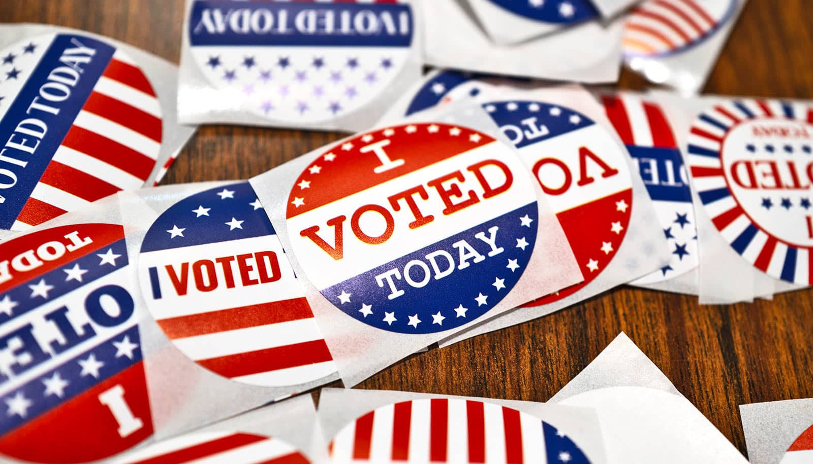

# 选对信息，就能修复选民对选举的信任

> 加州大学河滨分校参与的研究发现，选举官员只要用通俗语言、以事实说明安保措施，就能让选民对选举的信任平均提升 10 到 12.5 个百分点，且这种改善跨越党派界限；一段用手机自拍的非正式视频，效果几乎与专业制作相当。

简单、基于事实的选举安保视频，能跨越党派改善选民信任。

## 用事实视频回应阴谋论

选举官员可以借此重建公众对选举程序与结果的信任——即便是那些担心党派操纵的怀疑型选民。办法是制作视频，用通俗的语言、以事实说明他们的安保措施。

这是加州大学河滨分校（UCR）一位学者参与合著的研究结论，它为选举官员应对有关选举舞弊与安全的虚假说法和阴谋论、以及邮寄选票计票延误引发结果推迟时的疑虑，提供了切实可行的策略。

「如果选举官员提前解释清楚为什么可能出现延迟，选民就不太会做出负面反应。」UCR 公共政策学院助理教授、论文合著者 Jennifer Gaudette 说。相关研究分别发表于《Election Law Journal》《British Journal of Political Science》和《PNAS Nexus》。

## 信息真空里长出党派不信任

在近期发表于《Election Law Journal》的论文中，研究者考察了美国分散式选举制度的一个固有难题。各州虽有权自行制定选举规则，但大多遵循相同的安保程序，可选民通常对别州的选举如何运作知之甚少。党派性的不信任，恰恰会填补这块信息空白。

例如，Gaudette 与同事发现，全美范围内的共和党人更不信任民主党占绝对优势的加州选举，而全国各地的民主党人则对共和党主导的得州选举信心更低。

团队此前已证明，简单、基于事实的选举安保视频能提升选民对选举的信任。这一次，他们想知道，同样的信息能否改变选民对其他州的党派看法。

## 近1.5万人实验：信任跨党派上升

团队开展了涉及近 1.5 万人的问卷调查实验。参与者来自全国样本，以及得州、佐治亚州、科罗拉多州和洛杉矶县的样本。

部分人观看由选举官员制作、说明选票保护措施的视频。得州和佐治亚州的参与者观看关于加州选举的信息，科罗拉多和洛杉矶县的参与者观看关于得州选举的视频，全国样本则被分到加州或得州的信息。结果相当显著。

看完视频后，对目标州选举的信任平均提升了 10 到 12.5 个百分点，且这种改善跨越了党派界限：共和党人对民主党州选举更信任了，民主党人对共和党州选举更信任了，独立选民也有所上升。

这些发现说明，党派性的选举安全不信任，未必是铁板一块。「你可以通过给出事实来推动人们改变。」Gaudette 说。

## 手机自拍视频，未必输给专业制作

后续研究中的相关实验还表明，选举官员不需要好莱坞级别的制作水准也能改变人心。Gaudette 自己录制的、一段非正式的竖屏手机视频，效果与专业制作的视频差不多。

在那项研究里，Gaudette 坐在车里，用手机镜头对着自己讲话，解释了两条基本选举安全事实：投票机不接入互联网，计票过程有两党监督。超过 8000 名美国人参与了这项手机视频研究。一些人观看了 Gaudette 这段社交媒体风格的非正式视频，另一些人观看威斯康星州戴恩县和亚利桑那州马里科帕县选举官员制作的专业视频。

与什么都没看的人相比，自制视频带来的选举信任提升，与专业制作视频相近。它还更让人记得住：看过 Gaudette 手机视频的人，正确记住那两条选举安全事实的比例，比看过官方视频的人高出 8 到 9 个百分点。

年轻人尤其买账。18 到 24 岁的受访者中，只有 3% 称这段非正式视频有误导性，而 55 岁及以上者中有 15% 这么认为。

「州和地方官员应该努力在多种平台上与人沟通，因为社交媒体正是许多这类说法的爆发地。」Gaudette 说，「他们应该说明我们的选票是如何被妥善保管的、计票是怎样进行的，以及为什么有时会导致延迟。」

除 Gaudette 外，论文合著者来自加州大学圣迭戈分校、南加州大学包容性民主中心以及佐治亚大学。
