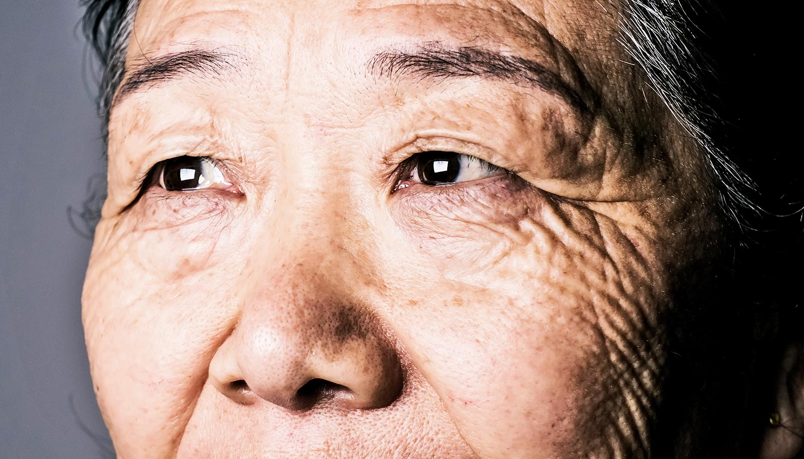

# 单剂基因疗法让成年视网膜「重新接线」，自己修好了视力

> 密歇根州立大学在成年犬身上做的视网膜基因疗法，不只延缓了遗传性失明，还促使成熟的视网膜细胞重建受损连接、重新变厚，并恢复视力——推翻了「成年哺乳动物神经细胞无法自我修复」的成见。

研究者本以为只会看到功能改善，没想到眼球的物理结构真的自己重新接了线。

## 本以为只是功能改善，结果眼睛自己重新接了线

一项新研究显示，单剂基因疗法在成年视网膜上做到的，不只是阻止遗传性失明——它真的促使成熟细胞重建了受损连接，并恢复了失去的视力。

密歇根州立大学兽医学院的研究人员此前用视网膜基因疗法让成年犬恢复了视力，他们预期看到的是功能上的改善。真正让他们意外的是眼球物理结构的变化：它自己重新接了线。

这项研究由助理教授、前住院医师 Billie Beckwith-Cohen 与教授 Simon Petersen-Jones 领衔，挑战了关于成熟哺乳动物神经细胞自我修复能力的长期假设。

## 把设计图里的错别字改回来

团队研究的是 CaBP4 基因疗法，用于治疗一种罕见的遗传性疾病——它会破坏感光细胞与大脑之间的钙信号传导。他们发现，这种疗法远不止是阻止病情进展。研究显示，单剂治疗促使成年视网膜重建受损连接、重新变厚，并恢复失去的视功能。

为了解释基因疗法如何恢复这条通路，Beckwith-Cohen 把基因突变比作建筑设计图上的一个错误。

「可以把视网膜基因上的突变，理解成设计图里的一个错别字，它让整套指令对系统来说变得无法理解，于是造出有缺陷的设计，视力随之丧失。」Beckwith-Cohen 说，「我们的疗法相当于为拼错的那一段提供新指令，就像一个编辑。」

## 三项独立的结构性变化

研究团队原本预期会看到功能恢复，但 Beckwith-Cohen 指出，在已经发育完全的视网膜上，物理层面的修复程度尤其令人信服。

「在这篇论文里，我们展示了三项支持成年视网膜可塑性的独立结构变化。」Beckwith-Cohen 说，「不仅加入了新的组件，原本就存在的异常也被修复了。」

## 为什么拿狗做模型

为了验证这种疗法，研究者选用了自然患上该病的犬只。Beckwith-Cohen 说，研究狗身上的自发疾病，是迈向治愈人类儿童失明的关键踏脚石。

「在寻找治愈人类疾病的踏脚石时，患有自发疾病的狗相比啮齿类等常见模型系统有两大优势。」Beckwith-Cohen 说。

「首先在于犬眼与人眼的相似性。狗的眼睛大、视力发育完善，高视锥密度区域带来比啮齿类更优越的视觉敏锐度。」

此外，这种病在狗身上是自然发生的，而非通过人工基因改造获得，因此更能可靠地反映基因突变在人类身上的表现方式。

CaBP4 突变引起的只是一种罕见的遗传性失明，但研究者相信，他们证明「成年视网膜能够修复受损神经网络」，为未来的治疗打开了更广阔的可能。成年眼睛仍保有重组与重建的能力——这意味着某些曾被视为永久性的视力丧失，或许终有一天可以恢复。

这些发现发表在《Molecular Therapy Advances》上。
