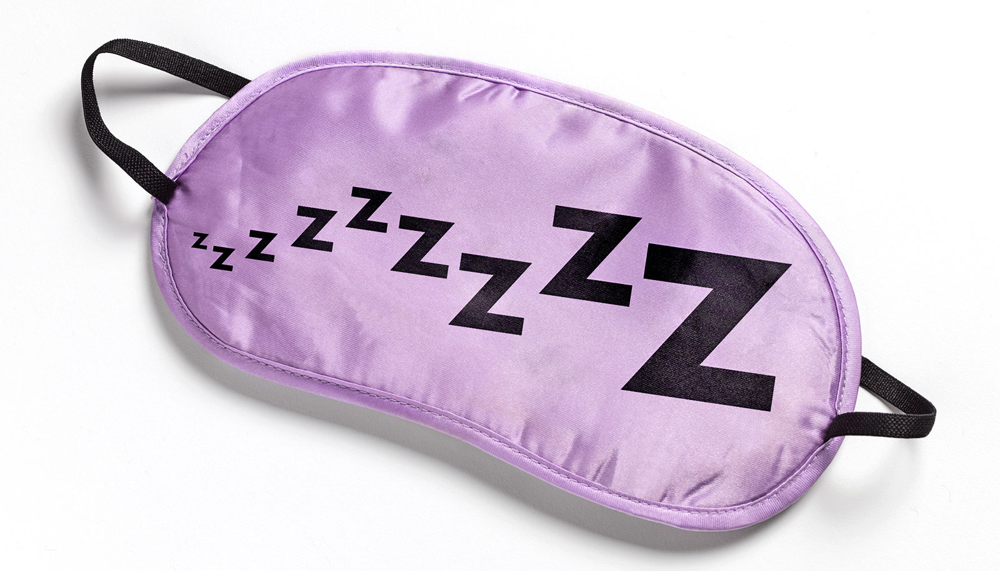

# 夜里那点灯光，可能正在改变你的心脏结构

> 一项覆盖 11017 人的研究发现，夜间光照最多的一组（超过 3 lux，约等于床头低亮度手机屏或门缝外的走廊灯），三年后左心室壁变厚、心室内部空间变小，心脏在搏动时的舒张能力也出现下降迹象。

比起年龄和基因，夜里关灯睡觉这件事，是你自己能控制的。

## 在近乎全黑中入睡，可能对心脏有额外好处

新研究表明，在几乎全黑的环境里睡觉，可能带来一项额外收益：保护心脏。

这项发表在《欧洲心脏杂志》上的研究由杜兰大学 Celia Scott Weatherhead 公共卫生与热带医学院完成。研究者发现，哪怕只是少量的夜间光照，也与心脏结构和功能上可能有害的变化相关。

「此前的观察性研究已经把夜间光照与更高的心血管疾病风险联系起来，但人们对相关的心脏结构和功能变化几乎一无所知。」该研究第一作者、杜兰大学系主任兼教授 Lu Qi 说。「我们做这项研究，就是想弄清当人们在夜间暴露于过多光照时，心脏随时间会发生什么。」

## 戴一周手环，三年后做一次心脏磁共振

研究团队分析了 11017 名参与者的数据。所有人都在手腕上佩戴传感器一周，测量整夜的暴露光照水平。一部分人处于 0 lux（近乎全黑），其他人则暴露在不同程度的光照下，最高的那一组超过 3 lux——大致相当于放在床头柜上的低亮度手机屏，或门缝外亮着的走廊灯。

三年后，每位参与者接受一次心血管磁共振扫描，以检查心脏结构和功能是否发生变化。结果显示，夜间光照水平最高的一组，左心室的壁变厚了，心室内部的空间因此缩小。同时也出现了心脏在一次搏动中舒张能力下降的迹象——这是心功能异常的早期提示。

## 「心脏重构」意味着什么

「这是同类研究中的第一篇，它表明夜间暴露于更高水平的光照与心脏重构有关。」Qi 说，「所谓心脏重构，就是心脏的结构和功能发生了变化。我们通常在心脏承受长期压力或损伤时看到这种情况。这是身体适应压力的一种方式，但最终会让心脏变弱，并可能导致心力衰竭。」

包括心脏病和中风在内的心血管疾病，是美国乃至全球的头号死因。夜间光照已被确认为这一致命疾病族群潜在的环境风险因素。与年龄或遗传不同，夜间光照是大多数人可以自己掌控的可变风险因素——只要关掉屏幕、睡前拉上窗帘，或者戴个眼罩。

「光污染已经成为心血管疾病的一个新风险因素。」Qi 说，「我们的发现，加上其他研究的证据，说明临床医生和政策制定者应当考虑把减少夜间光照纳入预防心脏病的可能策略之一。」
