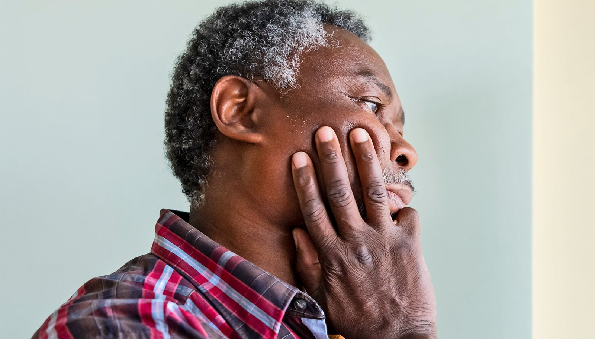

# 孤独与社交隔离，可能让你少活近六年健康时光

> 杜兰大学分析 27.7 万人的数据发现，同时承受孤独与社交隔离的人，无躯体疾病的寿命女性少 2.4 年、男性少 1.7 年；心理健康代价更大，女性少约 3.7 年、男性少约 5.8 年。

健康饮食和运动能部分抵消社交隔离的伤害，却几乎抹不平孤独带来的额外风险。

## 一半美国人正感到孤独

研究者发现，孤独与社交隔离正在让人们损失将近六年「没有抑郁、焦虑等精神障碍」的健康寿命，对身体健康的影响略小，但依然显著。

数字并不好看。一份 2023 年的报告显示，约半数美国成年人感到孤独，感到社交隔离的人数也差不多。这两者与其他健康风险同样严重，却长期没有作为紧迫的公共卫生议题得到足够重视。

那么孤独和社交隔离到底会让我们损失多少健康年数？此前研究者并没有明确答案——直到现在。杜兰大学 Celia Scott Weatherhead 公共卫生与热带医学院的团队完成了首例这类观察性研究，论文发表在《自然·通讯》上。

「总体而言，研究发现社交隔离与孤独会对无病预期寿命产生显著影响。」该研究第一作者、杜兰大学系主任兼教授 Lu Qi 说，「这既包括躯体疾病，也包括精神疾病。」

## 孤独和隔离不是一回事

虽然日常语言里孤独和社交隔离常被当作同义词、彼此关联，但在公共卫生研究者那里，它们是两个独立且不同的概念。社交隔离衡量的是一个人实际拥有多少社会联系的客观指标；孤独衡量的则是主观感受，即一个人对自己关系质量的不满程度——无论他实际上有多social。

「这些发现对我来说并不意外。」Qi 说，「此前的研究已经发现社交隔离和孤独与死亡率相关，尤其是过早死亡，而这项研究提供了更多证据。」

## 男性付出的心理代价更大

研究者追踪并分析了 277489 名 40 至 69 岁成年人的数据。这些人进入研究时都不患有七种主要慢性病：糖尿病、心脏病、肺病、痴呆、癌症、抑郁和焦虑。研究者以 50 岁为参照点，衡量孤独和社交隔离如何影响他们可以预期的无病年数。

与既无孤独也无社交隔离的人相比，两者兼有的女性无躯体疾病寿命少了 2.4 年，男性少了 1.7 年。心理层面的代价更大：女性无精神疾病寿命少了约 3.7 年，男性则少了约 5.8 年。

「这归根结底是男女之间的性别差异。」Qi 说，「我们的研究发现男性更容易受孤独影响。我们也知道女性通常比男性活得更久，在某些疾病上存在性别优势。」

## 健康生活方式能补一部分，补不了全部

值得注意的是，研究者发现更健康的生活方式——包括饮食、运动、睡眠和不吸烟——可以显著缩小社交隔离所带来的无病寿命损失。但更健康的生活方式并不能明显降低孤独带来的额外健康风险，这说明两种状况可能需要不同类型的干预。

未来，团队将研究不同人群，并通过临床试验检验因果关系。
