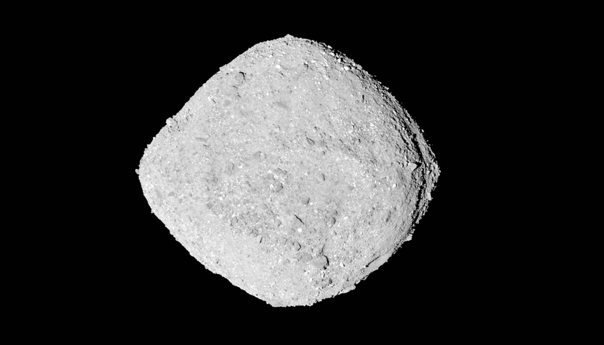

# 小行星贝努的身世被改写：它可能诞生在"冰线"附近

> 苏黎世联邦理工学院对 OSIRIS-REx 带回的贝努样本做同位素分析后发现，这颗小行星既不像来自太阳系内侧、也不像来自外侧，而很可能诞生在水结冰的"冰线"附近，背后还有木星在当"隔墙"。

对贝努样本的同位素分析改写了人们对其起源的认知，也揭示了早期太阳系中物质如何混合。

## 半克样本，从犹他沙漠到苏黎世

小行星贝努每 1.2 年绕太阳一圈，每六年靠近地球一次，最近时距离约 30 万公里。NASA 借此机会，用 OSIRIS-REx 探测器从贝努表面取样，2023 年 9 月 23 日，样本舱降落在犹他州的沙漠中，带回约 120 克物质。

其中一小部分是苏黎世联邦理工学院得到的。同位素地球化学教授 Maria Schönbächler 分到了半克，她的实验室立即着手分析。相关结果已发表在《Science Advances》上，不仅揭示了贝努矿物独特的化学"指纹"，也为太阳系的形成提供了新线索。

## 铁、钛、铬拼出的化学指纹

研究团队分析了铁、钛和铬的同位素——同位素是同一元素中质量略有差异的原子，它们组合起来能形成独特的指纹，用来判断小行星的来源，甚至在一定程度上推测其年龄。

测量显示，钛和铁在贝努上分布均匀。同时，贝努还有几位"近亲"：小行星龙宫（Ryugu）以及所谓的 CI 陨石——一类原始、富含碳的岩石天体，在地球上极为罕见。这三者的同位素指纹相似，说明它们来自同一片宇宙尘埃库；而与已知的其他小行星、陨石群和行星相比，它们的同位素组成又有显著差异。

## 推翻"来自外太阳系"的假设

此前，科学家一直以为贝努这类小行星形成于太阳系外围，或许和彗星的诞生地相同，而且形成时间相对较晚。新的数据把这两种想法都推翻了。

最可能的情形是：贝努、龙宫和 CI 陨石的"出生地"靠近水的冰线——也就是水蒸气凝结成冰的界限。45 亿年前太阳系尚未定型，内侧和外侧的物质在这一带混合；而冰起到"胶水"的作用，把最细小的尘埃颗粒黏合在一起。

Schönbächler 说，贝努是个"混合体"，其物质既不完全匹配太阳系内侧、也不完全匹配外侧，而是带有两者的特征，形成于两个区域物质交汇混合的特定地带。

## 木星，早期太阳系的"隔墙"

研究团队把贝努等天体的形成归功于木星。这颗气态巨行星在太阳诞生后不到一百万年就通过引力迅速成形。围绕恒星形成的尘埃与气体圆盘（其中含有水冰）里，行星和小行星通过吸积过程逐渐成形。

由于长得太快，木星在圆盘中像一根"桥墩"：它挡住了大部分粗颗粒物质，而来自圆盘各处的细尘则绕着它流动，在水冰边界附近的过渡带里均匀混合。贝努、龙宫和 CI 陨石的前身，正是在这里形成的。

这一图景也解释了为什么贝努的物质富含水：附近的冰蒸发后，部分水蒸气在贝努形成的区域重新凝结。同时，木星的"保护"作用让贝努主要由细尘构成，这也解释了为什么它的物质在化学上与太阳如此相似——在年轻太阳周围盘旋的细尘被彻底混合，就像家里的灰尘，时间一长什么地方都会有。

## 它可能是认识地球生命原料的一把钥匙

Schönbächler 认为，贝努也许是人们窥见类地行星最初化学元素混合的最佳窗口。它是一颗非常原始的小行星，物质可追溯到约 45 亿年前太阳系诞生之时，此后几乎没变过。

对贝努的地球化学分析正在完善人们对太阳系起源、行星形成条件的理解。由于它富含水和有机物，它也为年轻地球如何获得生命的"建材"提供了重要拼图。Schönbächler 还在追问：其他小行星是否也和贝努、龙宫拥有同样的同位素特征？年轻木星在"只让细尘聚集"这件事上到底起了多大作用，也有待进一步研究。

贝努样本的分析已经完成。这位教授眼下正热切期待日本向火星卫星火卫一发起的采样返回任务，该任务预计今年十月底发射。"如果能拿到这些物质，在我的实验室里分析，那会很令人兴奋。"她将向日本宇宙航空研究开发机构 JAXA 提出申请，不过还需要足够的耐心：装有火卫一样本的返回舱预计要到 2031 年才会回到地球。
