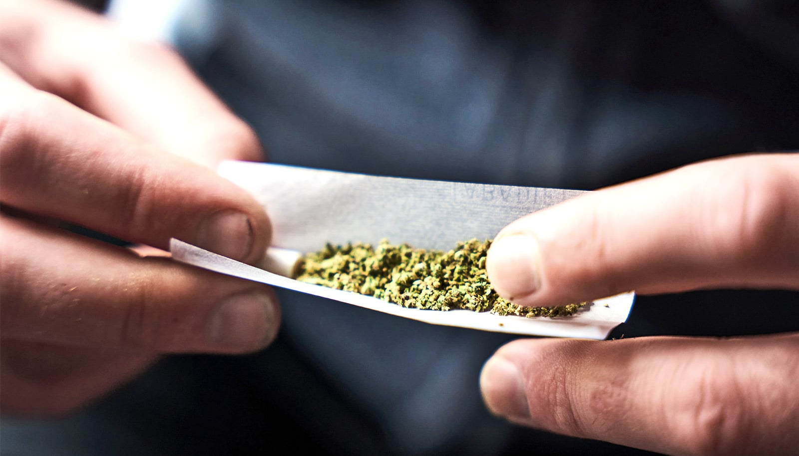

# 研究：经常吸食大麻的癫痫患者，发作更频繁、耐药更快

> 一项针对 64 名难治性癫痫患者的研究发现，几乎天天用大麻的人每年惊厥性发作次数是非使用者的两倍多，且从首次发作到药物失效平均只用 5 年，而非使用者是 18 年。

研究不能证明大麻加重癫痫，但这个关联足够让人警惕。

## 一天不落用大麻的人，发作次数翻倍

一项新研究发现，患有难治性癫痫的成年人中，几乎每天都使用大麻的人每年惊厥性发作的次数是非使用者的两倍多，而且更快对止痉药物产生耐药。

作者研究了 64 名耐药性癫痫患者——即两种或以上止痉药物都无法控制发作——他们被收治进专门病房，医生实时观察发作活动，以判断是否需要调整用药或手术。其中约三分之一的人报告自己几乎每天都在娱乐性使用大麻，而这些频繁使用者中有 90% 出现了最容易导致受伤和癫痫猝死的惊厥型发作，通常被称为大发作或全面性强直-阵挛发作。相比之下，非使用者中只有约一半出现过这类发作。

这些发现无法证明使用大麻会加重癫痫，但呈现出一个令人担忧的关联。

## 「我在门诊里看到的都是没道理的重症」

该研究的资深作者、圣路易斯华盛顿大学医学院神经病学副教授、Barnes-Jewish 医院癫痫讲席教授 Aaron F. Struck 说，这些发现说明值得直接向患者提出大麻使用的问题，尤其是那些为了失眠之类问题而使用大麻的患者——这类问题本来有更确证的疗法。

「目前没有确凿数据表明使用大麻会加重癫痫。」Struck 说，「但如果有人用大麻来缓解焦虑或助眠，我更愿意用我们了解的药物去治疗这些问题，而不是用一种基本不受监管、对大脑的影响我们其实并不清楚的东西。」

Struck 说，这项研究源于他近几年在娱乐性大麻使用兴起的背景下治疗癫痫患者时观察到的一个趋势。

「我遇到一些患者，发作非常可怕，癫痫非常严重，可他们身上没有任何预期的风险因素。」他说，「他们唯一的共同点就是频繁使用高浓度大麻。这是一个不受控制的变量，在我的门诊里出现得越来越多，而且没有人真正研究过它。」

## CBD 有用，但市面上的大麻恰恰相反

大麻中非精神活性的化学成分大麻二酚（CBD）的纯化制剂，已被美国食品药品监督管理局批准用于治疗某些严重的癫痫类型。但这种药不含四氢大麻酚（THC），也就是大麻中让人致幻的成分。动物研究显示 CBD 能抑制发作，而 THC 可能正好相反。近年对大麻效力的研究显示，娱乐市场上出售的大麻 THC 含量越来越高、CBD 越来越低。

为了探究频繁使用大麻与癫痫之间的关系，Struck 和其实验室研究员、该研究第一作者 Santiago Philibert-Rosas 分析了 2019 至 2024 年间在威斯康星大学医学院癫痫监测病房接受治疗的患者记录——两人当时都在那里工作。他们比较了 22 名频繁的娱乐性大麻使用者（报告每月使用 20 天及以上）和 42 名非使用者。

Philibert-Rosas 说，频繁使用者身上浮现出一组清晰的特征：二十多岁、以男性为主、没有常见的癫痫风险因素，而且从首次发作到被收治进监测病房的进展非常快。

总体来看，频繁使用大麻的患者发作更频繁、更严重。他们被送进住院癫痫监测病房——这本身就说明处方药已无法控制发作——平均发生在首次发作后 5 年，而非使用者是 18 年；尽管患癫痫的时间短得多，出院时却被开了更多的止痉药。

## 脑部扫描正常，问题可能出在电路上

这项研究无法确定频繁使用者更严重的临床表现是否由使用大麻造成。但研究者发现，在 15 名使用时间线可查的频繁使用者中，所有人都是在首次发作之前就开始使用大麻的，这降低了「他们是为了改善癫痫才开始用大麻」的可能性。

如此严重的癫痫通常会在海马体留下可见的瘢痕——海马体是大脑深处一个形似海马、与记忆密切相关的结构，也是许多发作的起点。但频繁使用者的脑部扫描基本正常，这让 Struck 认为，背后起作用的不是常见的疾病过程。THC 作用的受体恰好密集分布在这些相同的脑区，这提示这些患者的发作可能源于脑回路放电方式受损，而非物理损伤。

团队正在设计一项规模更大、多中心的研究，纳入大麻合法化历史不同的地区，并收集使用模式数据，比如多少人用、在什么年龄用、用什么形式，以触达更多样化的患者群体。研究者还计划不再依赖患者自述，而是在入院时加入客观检测指标，更准确地衡量人们到底摄入了什么。

「现在，当患者问我他的大麻使用是否影响了发作，诚实的答案是：我们不确定。」Philibert-Rosas 说，「更大规模的研究能帮我们给出真正的答案——多少量算多、停用是否有帮助——这样他们才能做出知情的决定。」

这项研究发表在《Epilepsia》上。
