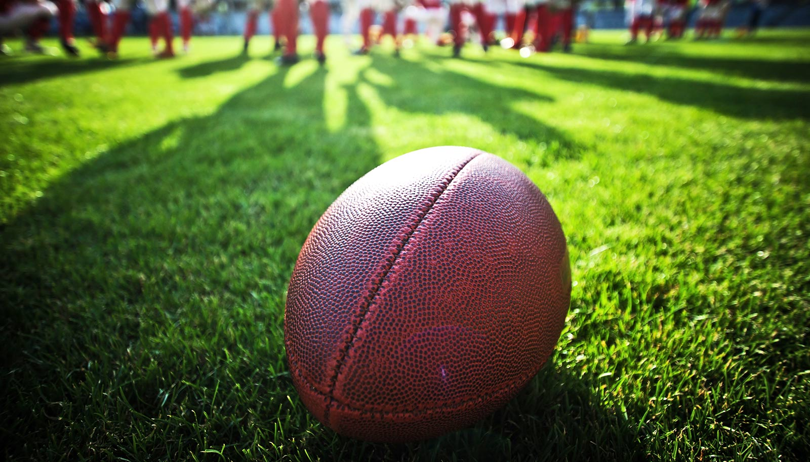

# 第四节被砍掉十分钟：极端高温正在改写美国大学橄榄球

> 南卡罗来纳大学 2026 赛季揭幕战，Williams-Brice 体育场体感温度飙到破纪录的 110 华氏度，第四节被硬生生缩短 10 分钟，急救和消防部门处理了 700 多起与高温相关的事件。

从每年约两次到每年约十次，极端高温事件正在把「安全暂停」变成赛季常态。

## 一场被高温改写规则的揭幕战

大学橄榄球是一项美国独有的传统。每个周末，数十万球迷涌向全国各地的校园，在停车场支起烤炉，与朋友家人相聚，再涌进体育场为主队呐喊。

但夏末的极端热浪正威胁着这种传统的体验方式，赛季最初几周尤其明显。上升的气温和湿度已经在引发安全延迟，有些情况下还把球迷送进了医院。

以 2026 赛季南卡罗来纳大学的揭幕战为例：由于 Williams-Brice 体育场内的体感温度飙升至创纪录的 110 华氏度，第四节被砍掉了 10 分钟。急救服务和消防队伍处理了 700 多起与高温相关的事件。

## 这并不是偶发事件

随着气候变化带来更频繁、更强烈的热浪，这类影响很可能越来越常见。据美国环保署（EPA）统计，极端高温事件的平均发生频率从上世纪 60 年代的每年两次，上升到 2010 至 2020 年间的每年十次。

## 不只球员，看台上的每个人都在高温里

北卡罗来纳州立大学公园、游憩与旅游管理系教授 Jonathan Casper，研究环境与可持续发展挑战如何影响体育赛事的组织、体验和实践方式。在他看来，极端高温对大学橄榄球的冲击不只是球员在高温下训练和比赛的风险，还包括看台上成千上万球迷的健康，以及整套比赛日体验能否继续安全、愉快地维持下去。

当一场赛季揭幕战需要靠删减比赛时间来保证安全，气候变化这笔账，已经递到了球迷手里的那张球票上。
