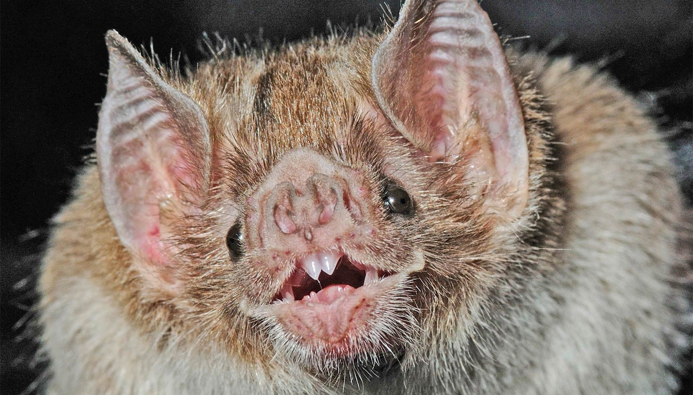

# 蝙蝠起源于欧洲，不是非洲或亚洲：迄今最大规模研究改写家族树

> 137 名研究者、64 个国家、103 个物种基因组加 44 种化石，发表于《自然》的这项研究首次重建了所有现存蝙蝠共同祖先的基因组，并证明回声定位和飞行一样，在蝙蝠演化之初就已出现。

飞行和回声定位几乎是同时在蝙蝠身上出现的，这或许解释了它们此后 6500 万年的演化成功。

## 起源地在欧洲，不在非洲或亚洲

迄今规模最大的蝙蝠基因组研究，结合蝙蝠化石证据后得出结论：蝙蝠约 6500 万年前起源于欧洲，而不是科学家长期以来认为的非洲、亚洲或北美。

这项研究还表明，回声定位和飞行一样，在蝙蝠演化的黎明期就已出现。发表在《自然》上的这项工作，有助于解决关于蝙蝠演化的学术争论，也改写了蝙蝠的家族树。

蝙蝠是唯一能动力飞行的哺乳动物。在欧洲起源之后，它们迅速扩散到非洲，继而遍布全球。全球有超过 1500 种蝙蝠，占地球哺乳动物总量的五分之一以上。蝙蝠通过为植物授粉、传播种子和吞食大量害虫，在世界上大部分地区维系着健康的生态系统。

## 137 位研究者，重建飞行哺乳动物的祖先基因组

这项研究首次重建了所有现存蝙蝠共同祖先的基因组，展示了「一只能够飞行的哺乳动物」的祖先基因组会是什么样子。来自 64 个国家、137 名研究者共生成并分析了 103 个物种的基因组数据和 44 种化石物种的性状特征。这个国际团队组成了 Bat1K 联盟，致力于为所有现存蝙蝠物种生成和分析参考级基因组组装。

「我们用来同时建模化石蝙蝠与现存蝙蝠演化的方法，能做到其他方法做不到的事：在纳入基因组数据的前提下识别最古老的化石蝙蝠类群，并揭示蝙蝠起源于何时、何地。」该全球研究团队的负责人之一、论文共同通讯作者、石溪大学生态与演化系教授 Liliana M. Dávalos 说。

团队用最先进的 DNA 测序和计算方法生成基因组，再与数十个古老物种的观察结果结合，汇集了迄今为止最大的蝙蝠基因组组装和化石样本集合。随后，他们应用了同时考虑蝙蝠形态与基因组变化、以及大陆随时间变迁的演化模型。

这让他们推翻了此前关于亚洲、非洲或北美起源的假说，转向欧洲起源。作者解释说，最早的后代先扩散到非洲，随后建立起一个欧非枢纽，蝙蝠从这个枢纽扩展到亚洲、美洲和澳大利亚。

## 泰国的大黄蜂蝠，马达加斯加的吸盘蝠

构建这套数据集是项艰巨任务。研究者几十年来在全球合作采集蝙蝠样本，其中包含一些分布在偏远地区、最为稀有和奇特的蝙蝠科代表。

比如泰国和缅甸的大黄蜂蝠，是地球上最小的哺乳动物之一；还有马达加斯加的吸盘足蝠，它们腕部和踝部长有吸盘，用来吸附在小叶片上。

## 飞行与回声定位，哪个先出现

大样本中的化石证据，还为另一个长期悬而未决的谜题提供了重要线索：蝙蝠何时首次演化出回声定位。

这项工作的关键在于把化石蝙蝠 Vielasia 放到了蝙蝠家族树最古老的分支上。这种蝙蝠具有指向回声定位能力的特征，因此表明回声定位早于现代蝙蝠的多样化。这一发现提示，蝙蝠生物学的两个标志性特征——动力飞行与回声定位——都演化于这个类群起源的附近。

作者认为，飞行和回声定位这两种早期能力，也解释了蝙蝠在此后 6500 万年间非凡的演化成功。

「几十年来一直有个问题：蝙蝠身上先出现的是飞行还是回声定位。」Dávalos 解释说，「这是因为蝙蝠若要在夜间飞行，感知方式必须有所改变，才能让它在黑暗中飞起来。」
