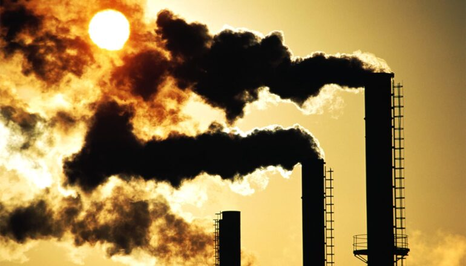

# 历史排放仍将使地球持续升温数十年

> 华盛顿大学研究显示，全球前178家碳巨头的历史排放将持续影响气候数十年，即便立刻停止排放，地球仍将比工业化前高出约1.5摄氏度。

 碳巨头已排放逾一万亿吨二氧化碳，其中很大一部分将在大气中滞留数千年。

## 从水淹房间到气候灾难

新研究显示，石油、天然气、煤炭和水泥行业的历史排放将在未来数十年持续影响环境，并推高极端天气出现的几率。

如果有人在你家浴室里任由水龙头淌水、房子被淹，追究损失责任很容易。但对更大、更昂贵、更复杂的其他灾难而言，因果之间的联系就没那么清晰了。

近年来，科学家改进了把极端天气事件（有时被称为气候灾难）与气候变化联系起来的方法。归因科学的进步厘清了燃烧化石燃料如何提高了极端天气发生的可能性。这些发现构成了一长串官司的支柱，起诉方试图让主要排放者为气候灾难中出现的死亡和损失负责。

## 升温会持续多久

华盛顿大学的这项新研究更进一步，表明碳巨头——排名前178位的石油、天然气、煤炭和水泥生产商——的历史排放将在未来数十年继续影响我们的环境。结果发表在《PLOS Climate》上。

"我们知道化石燃料排放造成了大量升温，也在目睹其影响，但问题是：这种升温会在未来持续多久？"华盛顿大学大气与气候科学副教授 Dargan Frierson 说。

即便温室气体排放明天骤降，环境也不会回到从前的样子。碳巨头已排放逾一万亿吨二氧化碳，其中很大一部分将在大气中滞留、困住热量，长达数千年。即便我们停止排放，地球仍将比工业化前温度高出约1.5摄氏度。

"我们预计气候会持续升温，直到我们停止化石燃料排放，"Frierson 说。"唯一稳定的未来，是彻底不燃烧化石燃料的未来。"

## 用模型算到2500年

为得出这一结论，研究人员使用"有限振幅脉冲响应"（FaIR）模型，在低排放和较高排放两种情景下、并分别计入和剔除碳巨头截至2024年的排放，模拟了到2500年的全球气候。

在温室气体排放受限的未来，碳巨头在高于工业化前的升温中所占比例更大。在排放持续攀升的较高排放情景下，地球随排放上升而变得更热；在测试的最极端情景中，未来排放造成的升温占比远高于碳巨头，但碳巨头带来的总温度变化大致相同。

"升温的量是可计算的，且相对独立于未来排放，"Frierson 说。"如果涉及责任的司法裁决，责任不只在于当下，而会延续到未来许多许多年。"

## 责任不只存在于当下

温室气体与全球变暖的关系并不新鲜，事实上科学家数十年前就已认清风险。追究排放者责任的关键，在于指控企业明知这些风险却对公众隐瞒，有时还使用欺骗性手段散布虚假信息。

这项新研究显示，主要排放者在开采和燃烧化石燃料过程中释放的气体，可能还要为尚未发生的事件负责：过去的排放会通过持续的升温提高未来灾难发生的几率。

"这对当下关于化石燃料的决策很重要，"Frierson 说。"未来的化石燃料生产将在今后数十年加剧气候灾难，因此围绕谁该负责的新一轮法律战预计还会持续多年。"

