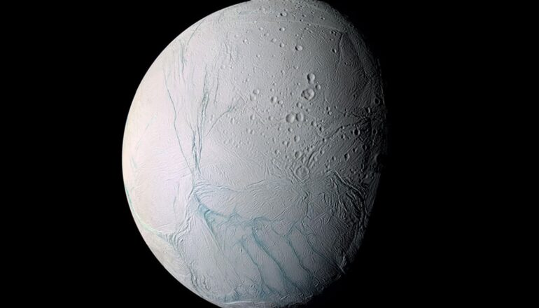

# 土卫二冰喷流中的盐分分选，或助寻找外星生命

> 研究人员发现，土卫二喷流中的海水在冻结时会把盐分自然分离并浓缩进单颗冰粒，类似过程或同样能把生命分子浓缩，使未来探测器更容易发现地外生命痕迹。

土卫二南极的冰喷流为寻找地外生命提供线索。

## 一颗藏着海洋的冰卫星

研究人员报告，土星卫星上冰冷喷口里海水盐分的自然分选，可能有助于寻找生命。

土卫二（Enceladus）在厚厚的冰壳之下拥有一片全球性液态水海洋，是地球之外最有望存在生命的地方之一。一项新研究指出，这颗卫星本身或许就能为这种搜寻提供帮助——它让海洋中的某些化合物更容易被未来航天器探测到。

在土卫二南极，水蒸气和微小冰粒从海洋中喷发，延伸数百英里进入太空，滋养着土星的E环。NASA的卡西尼号探测器2004年抵达土星，多次穿越这道喷流，无需着陆、也无需钻穿数英里厚的冰层就能采样海洋物质，并探测到盐类、有机化合物，以及月球岩石质海底存在水岩相互作用的证据。

## 每颗冰粒并非海水的简单样本

这项发表在《科学进展》上的研究，考察了海洋喷雾冻结、并沿冰层裂隙移动时，不同盐类如何分离并在不同冰粒中浓缩。关键在于，类似过程可能把有机分子乃至分子级生物特征浓缩进单颗冰粒，使未来航天器更容易探测到它们。

研究分析了卡西尼号宇宙尘埃分析仪记录的近1000颗富盐冰粒。有些冰粒富含氯化钠，另一些则以碳酸盐、磷酸盐、氢氧化物或含钾盐类为主。

“我们表明，每一颗冰粒并不一定是海洋的一小勺，”研究合著者、加州大学河滨分校行星科学助理教授Fabian Klenner说，“它更像是一滴更大海洋液滴的碎片，冻结过程中盐类先被分离，之后液滴才破裂。”

## 实验室重现冻结分选过程

为还原这一过程，研究人员把卡西尼号数据与实验室实验、热力学计算以及液滴冷却模型结合起来。实验中，他们冻结了配方模拟土卫二海水的碱性盐水液滴：冷却相对较慢的较大液滴会形成明显的富盐区域，而最小、冻结最快的液滴则更为均匀。

“当这些液滴冻结得相对较慢时，不同的盐会在同一颗冰粒内分离到不同区域，”Klenner说，“比如氯化钠可能集中在一处，氯化钾集中在另一处。当冰粒在喷口被加速时，与冰壁的碰撞会把它撞成成分各异的小碎片。这就是我们提出的机制。”

研究团队的模型从海面气泡破裂产生喷雾液滴开始。水蒸气把液滴带出喷口，其间液滴冻结得足够慢，使不同的盐得以分离。更靠近地表处，狭窄的通道把蒸汽和已冻结的液滴加速到每小时数百英里，与冰壁的碰撞再将它们撞成微米级的碎片。

## 对寻找生命的启示

“土卫二其实替我们做了大量本需在地球化学实验室里费力完成的样品制备工作，”领导该研究的柏林自由大学行星科学教授Frank Postberg说，“海洋成分被彼此分离，同时又被浓缩进单颗冰粒。”

这一发现也改变了科学家解读喷流样本的方式。单颗冰粒未必代表海洋的平均成分。把许多颗粒合并成一次测量，可能抹掉这种自然分选、掩盖稀有化合物；而逐颗分析冰粒则能保留这些信息。

“分析大量单颗冰粒能提高我们找到有趣成分的机会，也让我们对整个海洋有更好的认识，”Klenner说，“最有用的信息恰恰在于冰粒之间的差异。未来任务应尽可能多地分析单颗冰粒。”

Klenner表示，相关物理过程或许还能解释为何某些有机化合物只在少部分土卫二冰粒中以高浓度出现。“这告诉我们在土卫二上寻找生命的一些重要信息，”他说，“生命的分子特征如果存在，可能只浓缩在少数冰粒里。未来航天器必须恰好找到那些冰粒。”

