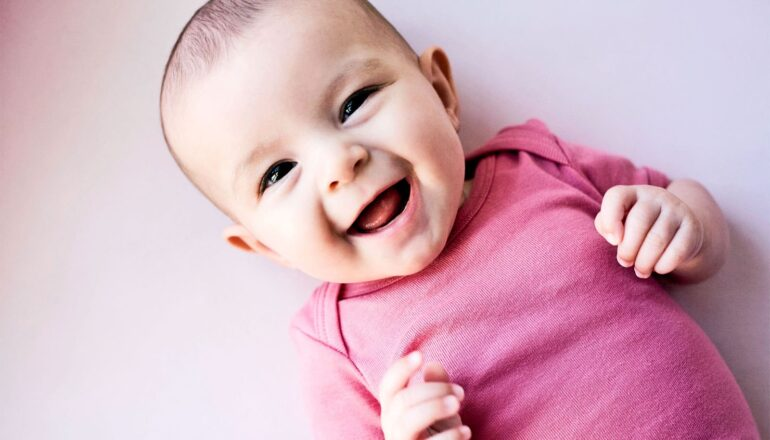

# 对婴儿微笑 有助其情绪发育

> 近千名4个月大婴儿的心率数据显示，只有当母婴同时露出积极表情时，婴儿的心率变异性才会上升，而这种生理变化与情绪调节能力密切相关。

 育婴互动中的微笑与回应，可能为婴儿的情绪调节打下生理基础。

## 一起微笑不只是温馨

母亲和婴儿相视而笑，不只是一种温馨互动——这种积极的交流会帮助婴儿发展情绪调节能力以及情绪健康的生理基础。这是基于一项新研究的结论，该研究测量了近1000名4个月大婴儿在与母亲愉快互动时的心率变化。

研究发表在《英国皇家学会哲学汇刊B辑》，发现情绪发育可能正是通过婴儿与照护者之间的积极交流（比如微笑和大笑）塑造的，因为这些互动促成了对情绪调节至关重要的婴儿生理变化。

"玩耍不只是嬉戏，它在影响婴儿的生理状态，"论文资深作者、迈阿密大学心理学系教授 Daniel Messinger 说。"积极的社交互动与婴儿的这种内在状态存在某种关联，婴儿的生理状况与互动中发生的事情紧密相连。"

## 用心率记录互动过程

为观察婴儿的社交互动如何影响心率，研究人员把电极贴在婴儿的胸部和腹部，同时受过训练的观察者观看他们与母亲的互动，逐刻记录母婴双方表现出的是积极、中性还是消极的投入。借助心率数据，研究人员随后计算出呼吸性窦性心律不齐——即与呼吸相关的心率变异性，这被视为与情绪调节和适应不同环境相关的生物指标。

研究人员发现，当婴儿和母亲同时处于积极投入状态时，心率变异性上升。重要的是，当只有婴儿在微笑、或只有母亲表现出积极情绪时，他们没有观察到同样的生理变化。

"双方都得是积极的，"同时也是儿科教授的 Messinger 解释道。"当他们同时积极，尤其是持续时间较长时，你就能看到婴儿心率上升。"

## 妈妈的笑容最管用

这项研究是一个覆盖全美四地（包括迈阿密）、由多所大学参与的有关药物暴露的全国性研究的一部分。研究人员在分析数据时控制了产前药物暴露和社会逆境因素。团队成员包括迈阿密大学校友 Samantha G. Mitsven，她在攻读发展与儿童心理学博士期间参与了这项研究。

Messinger 还参与了另一项关于婴儿微笑的研究，同样近期发表于《英国皇家学会哲学汇刊B辑》，考察婴儿与成人如何相互影响彼此的微笑。研究人员观察了58名4个月和8个月大的婴儿与母亲、父亲及一名陌生人的互动，发现成人发起和回应微笑互动的比例高于婴儿，看到成人微笑会显著提高婴儿开始微笑的频率；而婴儿更可能结束共享的微笑时刻，这可能说明他们正在学习控制自己的兴奋。

研究人员还发现，与4个月大时相比，8个月大的婴儿更可能主动发起微笑互动，也更可能回应成人的微笑；与父亲和陌生人的互动相比，两个年龄段的婴儿都最可能回应母亲的微笑。

"重要的是，这是第一篇不仅涉及爸妈、还涉及陌生人的论文，"Messinger 说。"陌生人发起和维持微笑的比例高于妈妈，但婴儿更可能对妈妈回以微笑。所以，这里亲子关系确实起作用。"

