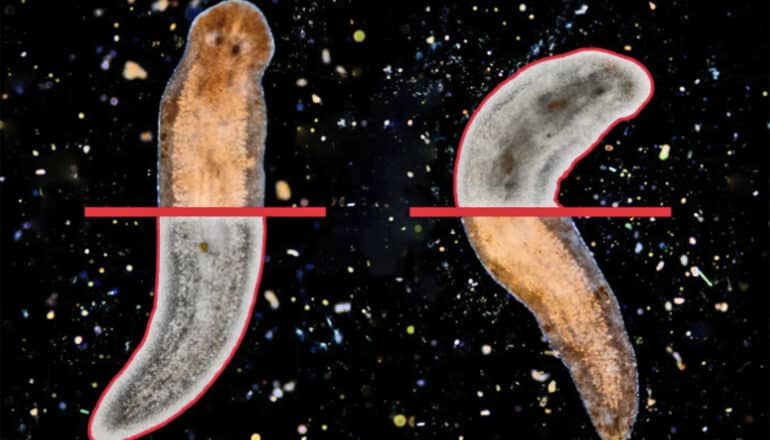

# 扁平虫能重建大脑 人类能否复制这一能力

> 佐治亚大学研究人员在一种扁平虫体内锁定近十个基因，它们能指令干细胞变成多巴胺神经元，并把新神经元引向虫体内的正确位置。

 扁平虫仅凭一小片身体碎片就能重长出整个身体，甚至包括大脑。

## 大脑为何难以自愈

一项新研究锁定了帮助扁平虫再生大脑的基因。人类大脑在遭遇损伤或疾病后极难自我修复，但一些动物却能调动自身的细胞能力，不仅修复伤口，还能把整个大脑重新长出来。佐治亚大学的研究人员就在一种扁平虫体内找到了若干个让大脑再生成为可能的基因。

"宏观来看，我们希望能为如何更好地激发人类大脑自我再生找到思路，"研究通讯作者、佐治亚大学富兰克林文理学院副教授 Rachel Roberts-Galbraith 说。"借助简单动物获得的关于大脑再生的认识，让我们有理由保持乐观。大脑不善于再生并非其固有属性，而是人类特有的问题。"

## 扁平虫的再生本领

扁平虫和人的大脑都由叫作神经元的特化细胞网络构成，这些细胞通过电信号或化学信号彼此交流：有的负责感知光和触碰等刺激，有的控制运动。

受伤后，扁平虫用干细胞替换神经元。人类同样有干细胞，但它们无法高效地转变为新神经元来愈合损伤。这项新研究揭示了共享基因在扁平虫体内如何工作，为研究人员探索人类体内可能被激活的类似通路、从而设计出针对创伤性脑损伤或疾病更好的疗法打下基础。

涡虫遍布淡水、海水甚至陆地，没有循环或呼吸系统，却拥有能随时变成身体所需任何细胞的干细胞，因而是研究大脑与认知的宝贵动物。凭借干细胞，涡虫仅凭一小片身体碎片就能重新长出整个身体，重建组织、肌肉乃至大脑。

## 找出基因配方

但这些微小生物如何知道该造什么细胞、又该把它送到哪里？这项发表在《自然·通讯》上的研究识别出近十个基因，负责指令干细胞变成产生多巴胺的神经元，并引导这些新神经元前往虫体内的正确位置，这类神经元也存在于人类和其他动物身上。

多巴胺被称为"快乐"化学物质，但它不只是大脑的奖赏与愉悦信号，还帮助神经元彼此交流，并在控制运动方面扮演关键角色。例如帕金森病患者正是因为多巴胺水平偏低而出现震颤和僵硬。

当研究人员敲除本研究中发现的某些基因后，涡虫难以造出新的多巴胺神经元，还表现出动作迟缓，与人和哺乳动物多巴胺不足造成的影响相似。

## 通往人类疗法的路径

目前医疗界治疗帕金森病、阿尔茨海默病或创伤性脑损伤的选择并不多。若能像涡虫那样调动人体自身细胞来修复创伤，将是颠覆性的突破。

"我们弄清了在涡虫体内制造这些细胞类型的基因配方，"Roberts-Galbraith 说。"我们希望这项工作能帮助他人弄清楚如何从干细胞制造出多巴胺神经元，从而更有效地移植给患者。"

