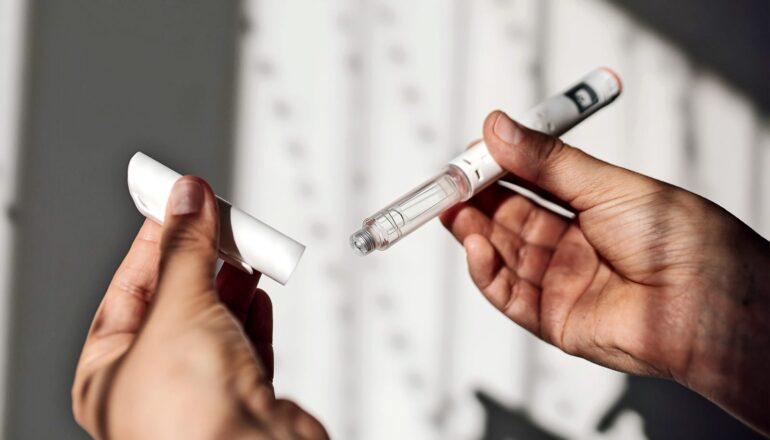

# 药价越贵 患者越不愿坚持服用GLP-1

> 一项覆盖8914名患者的研究发现，当GLP-1的月自付费用超过75美元这一临界点，停药比例飙升至八成以上。

 对不少患者而言，每月75美元是决定是否继续用药的分水岭。

## 高自付费用拖累用药

一项新研究显示，患者并未按处方服用GLP-1减重药物，原因往往是自付费用过高。这项发表在《JAMA Health Forum》上的研究分析了8914名因减重开始服用GLP-1、并在整个一年半研究期内持续参保的患者的用药依从性，GLP-1的费用被划为五档：0至21美元、22至43美元、44至75美元、75至168美元，以及168美元以上。

## 75美元成为分水岭

即便在费用最低的一档，停药率也很高：四分之三的患者在拿到第一张处方后一年内停用了GLP-1。但研究人员发现，在75美元附近出现了明显的骤降——当月自付费用超过这一数额时，不依从率升至八成以上。

"这让我很意外，因为我最初做这项分析时，预期更高的自付费用与更低的依从性之间存在清晰的线性关系，但事实并非如此，"第一作者、佐治亚大学公共卫生学院卫生政策与管理助理教授 Eunhae Shin 说。"在人们触及75美元这个临界点之前，依从性都差不多。"

## 谁最容易掉队

GLP-1依从性低可能源于多种因素，包括身体副作用或保险政策。虽然本研究未直接测量，但年中的保单变更、事先授权要求，或"阶梯疗法"（要求先用较低价药物，再升级到疗效相近但更贵的选项）都可能中断处方的延续。

联邦项目已将符合条件的医保（Medicare）患者在GLP-1上的自付支出上限设为50美元，但商业保险公司并未采取类似的价格上限。

"这基本上意味着，拥有雇主保险的人可能仍要面对这些经济障碍，"Shin 说。"政策制定者、监管机构和保险公司都应考虑这一点。如果他们的目标是提高用药依从性、让尽可能多的人从这些药物中受益，我们就该开始思考如何重构自付费用和保险设计。"

依从率最低的大约17%，出现在每月自付168美元及以上的患者中。这一群体更可能居住在美国南部各州，并持有高免赔额保险。虽然研究未直接分析社会经济因素，但先前研究表明，低收入人群更可能投保高费用分担、低保费的险种——在这类计划中，患者往往要在达到免赔额前承担GLP-1的全额费用，而免赔额可能高达数千美元。

## 短期支出与长期收益

"这意味着更脆弱的人群处在这些高支出区间，进而可能导致更低的用药依从性，"Shin 说。

肥胖会增加心脏病、2型糖尿病、高血压等慢性病的风险，慢性病患者还可能面临更高的医疗支出和突发的昂贵急诊或住院开销。Shin 希望未来研究能证明这类药物的长期经济收益。

"尽管短期内自付费用可能相当可观，但从长远看，我们或许能借助这些药物更好地管理慢性病，"Shin 说。"如果能减少急诊就诊和住院，就可能带来长期的成本节约。"

