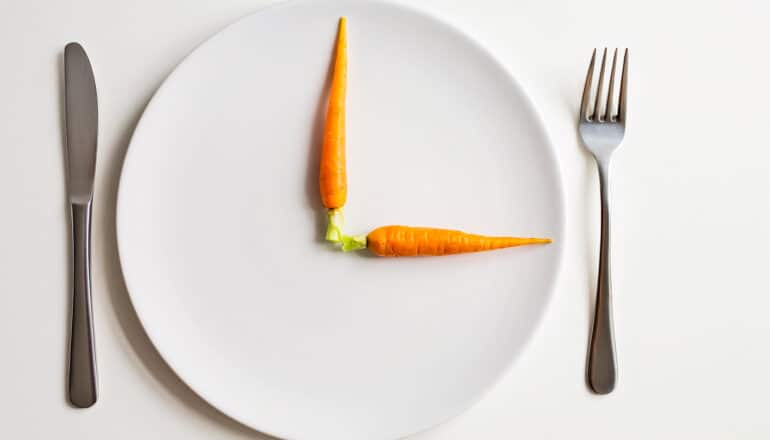

# 限时进食帮助肥胖与糖尿病前期成年人减重

> 一项新研究显示，在保证热量摄入不变的前提下每天只在10小时内进食，可让肥胖并伴糖尿病前期的成年人小幅减重约2.7%，但并未带来独特的全身性健康益处。

限时进食或帮助肥胖及糖尿病前期人群减重。

## 只在一段10小时窗口内进食

一项新研究提供了证据：限时进食能让同时患有肥胖和糖尿病前期、或患有饮食控制的2型糖尿病的成年人出现小幅减重。

限时进食是一种间歇性禁食，指每天只在固定的一段8到10小时窗口内进食。

这项发表在《肥胖》期刊上的研究，是约翰斯·霍普金斯医学院医学助理教授、研究第一作者Daisy Duan领导的持续性研究的最新成果，探讨不限制热量的限时进食如何改变体重和身体其它功能。

Duan表示，其它关于限时进食的研究，探讨的是它配合有意识或无意识热量限制的效果。而这项新研究关注的是：在保证热量摄入一致的前提下限制进餐时间，是否会改变进食行为、炎症和食欲激素等其它与肥胖相关的因素。

## 严格控制热量的对比实验

美国有超过1亿肥胖成年人和1.15亿糖尿病前期成年人面临高血压、心脏病发作和中风等心脏代谢并发症的更高风险，而且这些数字预计还会上升。间歇性禁食——这个统称指调整“何时吃”而非减少热量或回避某些食物的结构性禁食与进食模式——已普遍被认为与减重相关，可能对患有一种或两种状况的人有益。

为了拓宽临床对基于时间的饮食干预的理解，Duan团队考察了间歇性禁食等限时饮食方案带来的健康益处，究竟只是减重的结果，还是也涉及其它生物学机制。

在这项为期12周的研究中，以女性和黑人为主（均占92%）、年龄18至69岁、患有肥胖并伴糖尿病前期或饮食控制2型糖尿病的成年人，被随机分配到10小时限时进食组（19人）或16小时常规进食模式组（20人）。

所有参与者都采用同一套改良版DASH饮食——一种强调限制红肉、高脂食物、糖和盐摄入的心脏健康饮食，每个人的热量摄入都被个性化设定，以维持其起始体重。所有餐食均由马里兰州巴尔的摩的约翰斯·霍普金斯ProHealth临床研究部在研究营养师监督下准备和提供。

## 两组都出现小幅减重

研究前后，参与者都提供了空腹血样，用于测量炎症标志物和食欲激素水平，并填写了一份三因素饮食问卷——一种刻画一个人如何与食物互动和思考的工具。研究人员用两者追踪并比较身体与心理上的变化。

值得注意的是，研究结束时，限时进食组（中位数2.7%）和常规进食模式组（中位数2.5%）都出现了相似的小幅减重。

研究结束时，两组参与者都报告对食物的克制更强、压力性进食倾向更低、整体更不易感到饥饿。不过，食欲激素（饥饿素和瘦素）和炎症标志物（C反应蛋白、皮质醇和sRAGE）在限时进食组和常规进食组之间并无差异。

## 并非靠热量限制，也无独特益处

“我们发现，遵循10小时限时进食的人在不限制热量的情况下减了重，也改善了饮食习惯，”Duan说，“但除此之外，我们并未发现这种饮食策略带来任何独特的、全身性的健康益处。”

## 下一步研究方向

研究的未来方向包括：探讨限时进食如何影响那些已通过其它干预（比如GLP-1受体激动剂）成功减重的人维持体重。

除Daisy Duan外，该研究的作者还包括Susan Carnell、Scott J. Pilla、Stephanie T. Chung、Jeanne M. Clark和Nisa M. Maruthur。

作者披露了利益冲突：Duan是Rhythm Pharmaceuticals的顾问并从美国糖尿病协会获得酬金；Carnell获得礼来公司的资助；Clark参与礼来公司的数据安全监测委员会，并在诺和诺德顾问委员会任职；Maruthur从UpToDate获得版税。其它作者声明无利益冲突。该研究由美国国立卫生研究院和美国心脏协会资助。

