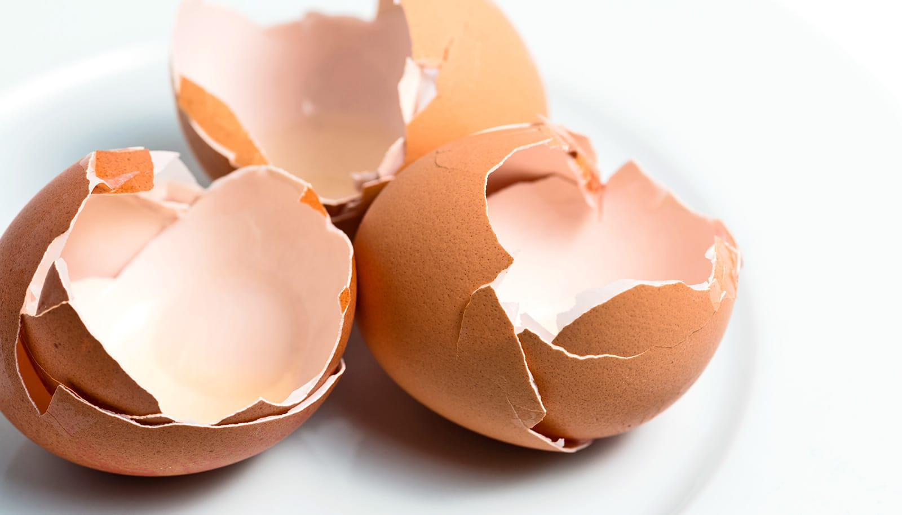

# 用鸡蛋壳造出更强、更轻的镁合金

> 北卡州立大学的研究者用磨碎的鸡蛋壳替代传统钙原料，通过“搅拌摩擦挤压”工艺造出高强度镁合金。鸡蛋壳 95% 是碳酸钙，这条路线省掉了从矿石提钙的繁琐步骤，更便宜、更省能，也更可持续。

鸡蛋壳正从厨余垃圾变成合金原料。

## 把矿石那一步跳过去

北卡州立大学的研究团队展示了一种用鸡蛋壳粉末生产高质量镁合金的技术。镁合金在汽车、航空航天和生物医学领域用途广泛，而鸡蛋壳在这里充当了传统钙原料的低成本、可持续替代品。

“碳酸钙和氧化钙是制造金属合金的重要原料，但生产它们依赖一套以矿石为基础的复杂流程，”论文通讯作者、北卡州立大学材料科学与工程助理教授 Bharat Gwalani 说。“我们展示的技术可以跳过一步：不必先把矿石加工成钙原料、再用它去炼金属或合金，我们证明可以直接用鸡蛋壳造出高质量的合金。”

## 一场高速旋转中的化学反应

鸡蛋壳 95% 是碳酸钙，研究者的工艺把它转化为氧化钙和初生钙。具体做法是：在一块圆柱形镁锭上钻出一排均匀分布的小孔，把磨细的蛋壳粉填进去；再把镁块放进钢制圆筒，一根中心带孔的钢制芯棒缓缓压下，像研钵里的杵一样，一边施压一边以每分钟 300 转的速度旋转。

这套工艺叫“搅拌摩擦挤压”（friction stir extrusion）。芯棒下压旋转时，几件事几乎同时发生：蛋壳粉被混入周围的镁中，颗粒与金属之间产生摩擦，而摩擦把碳酸钙转换成氧化钙和钙，同时生成高强度的 Mg2Ca 合金；最后，芯棒向下的压力把合金从中心孔挤出，成为一根成品棒材。

相比传统路线，它的好处很直接：步骤更少、供应链可靠而可持续、鸡蛋壳便宜，而且因为不用走“矿石到钙产品”的流程，能耗大幅降低。

## 不止于镁和蛋壳

“这项工作表明，你可以用廉价、可持续的生物质废料，生产高价值、高质量的镁合金，”Gwalani 说，“这是一种可规模化、节能且对环境负责的路线。”

他透露，这一思路还能拓展到别的材料组合：“今年早些时候我们已经证明，可以用同样的搅拌摩擦挤压工艺，把磁性钐钴（SmCo5）粉末研磨进废铝里，制成磁性复合材料。”论文发表在《镁与合金杂志》（Journal of Magnesium and Alloys）上。

