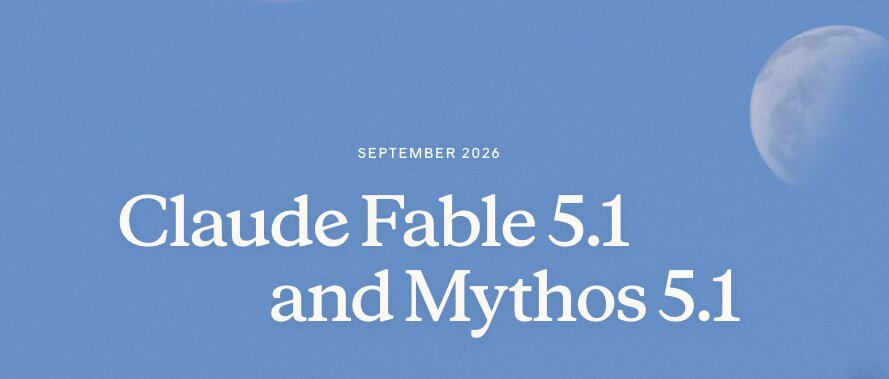

# Anthropic Fable 5.1与Mythos 5.1更强且便宜45%

> Anthropic发布Fable 5.1与Mythos 5.1，能力提升且缓存读降价带来典型25%、重度代理高达45%的成本下降。

Anthropic发布Fable 5.1与Mythos 5.1，能力提升且缓存读降价带来典型25%、重度代理高达45%的成本下降。

## 核心看点

Anthropic released FAble 5.1 and Mythos 5.1 and they continue to get better at agentic coding and scientific research.

Fable 5.1 will cost an estimated 25% less than Fable 5 for typical workloads, wherever usage is billed by token. This is because we’re reducing our pricing on cache reads (where the model reads inputs that have already been processed and stored). For highly agentic work, the savings will often be much larger—up to approximately 45%.

Here is the link to the Anthropic description.

Mythos 5.1 developed full working exploits in 98% of trials, up from 88%. Anthropic says these are the strongest cyber capabilities of any model it has released.

52.6% on Terminal Bench Science, more than double Fable 5, and evaluated with production safeguards on, so it understates the real ca...

## 延伸

NextBigFuture 原文提供了更多背景与数据，更多细节以原文为准。文末以画面感收束：当数据与算力持续堆高，下一波突破已在路上。
