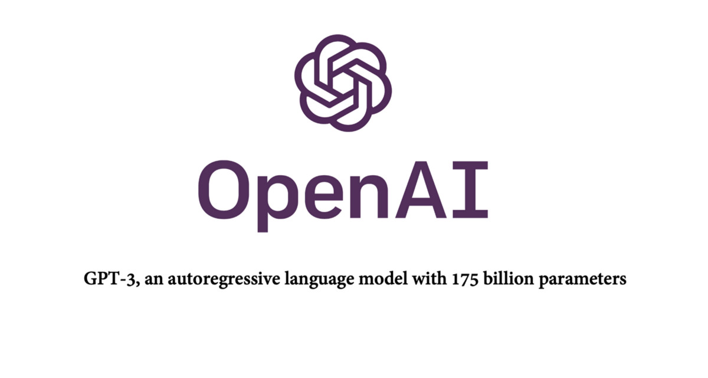

# OpenAI Astra数日内发布，Grok 4.7与Fable 5.2同月登场

> OpenAI Astra进入发布前最后安全加固，获评首个Critical网络安全级别，预计数日内发布，Grok 4.7与Fable 5.2亦在9月登场。

OpenAI Astra进入发布前最后安全加固，获评首个Critical网络安全级别，预计数日内发布，Grok 4.7与Fable 5.2亦在9月登场。

## 核心看点

OpenAI Astra is getting cybersecurity safeguards but will be released soon. It will like release before the end of the week. OpenAI said it might reach a critical level of cybersecurity capability. Astra meets the Critical cybersecurity capability threshold under the OpenAI Preparedness Framework. It is the first model OpenAI have designating at this level, and requires stronger safeguards during development and before release.

Over the past several weeks, they have delayed parts of Astra’s development.

Grok 4.6 and Fable 5.1 are now alone on the CursorBench pareto frontier.

Should evolve rapidly over the next few weeks as Astra, Grok 4.7 and Fable 5.2 are released. pic.twitter.com/2fU3w6DgiH

— Gavin Baker (@GavinSBaker) September 1, 2026

Known for identifying cutting edge technologie...

## 延伸

NextBigFuture 原文提供了更多背景与数据，更多细节以原文为准。文末以画面感收束：当数据与算力持续堆高，下一波突破已在路上。
