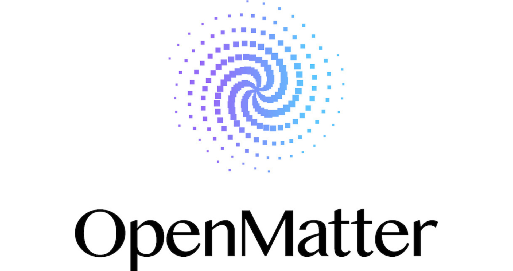

# OpenMatter扩展平台加码安全AI与数据协作

> OpenMatter扩展平台能力，推出MatterSDK/Vault、Model Router与MatterML V2，加码安全AI与数据协作。

OpenMatter扩展平台能力，推出MatterSDK/Vault、Model Router与MatterML V2，加码安全AI与数据协作。

## 核心看点

Melbourne, Florida, September 2nd, 2026, CyberNewswire

Less than three months after its commercial launch, OpenMatter Network today announced a significant expansion of the platform with new capabilities that make it easier for enterprises, developers and researchers to build, deploy and collaborate using sensitive data and AI while maintaining cryptographic control over how information is accessed, computed and shared.

The new capabilities, available now as part of the commercially available OpenMatter Network platform, span secure application development, AI model management, privacy-preserving machine learning and data collaboration. More importantly, they demonstrate one of the founding principles of the company: the platform is not a fixed solution for today’s computing environment,...

## 延伸

NextBigFuture 原文提供了更多背景与数据，更多细节以原文为准。文末以画面感收束：当数据与算力持续堆高，下一波突破已在路上。
