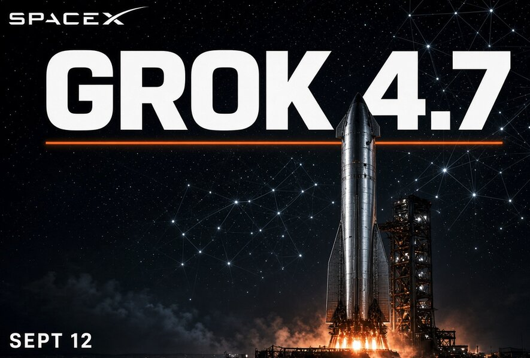

# SpaceX AI Grok 4.7定档9月12日发布

> SpaceX AI宣布Grok 4.7将于9月12日发布，据称为2.1T参数全新预训练。

SpaceX AI宣布Grok 4.7将于9月12日发布，据称为2.1T参数全新预训练。

## 核心看点

Elon Musk posted on September 2, 2026 that Grok 4.7 comes out in 10 days so September 12.

2.1 trillion parameters — a new, larger pretrain, up from Grok 4.6’s 1.5T base.

Elon has said it will be better than 4.6 in every way except that it will be slightly slower to serve, with better token efficiency.

Grok 4.7 comes out in 10 days https://t.co/ZSXmzVFqB1

— Elon Musk (@elonmusk) September 2, 2026

Initial pre-training was finished by mid-August. There has been supplemental training on a large amount of SpaceX company data.

Grok 4.7 will exceed all current models. So better than Fable 5 but not Fable 5.1 Grok 4.7 model will be the best at real-world engineering.

Known for identifying cutting edge technologies, he is currently a Co-Founder of a startup and fundraiser for high potential ...

## 延伸

NextBigFuture 原文提供了更多背景与数据，更多细节以原文为准。文末以画面感收束：当数据与算力持续堆高，下一波突破已在路上。
