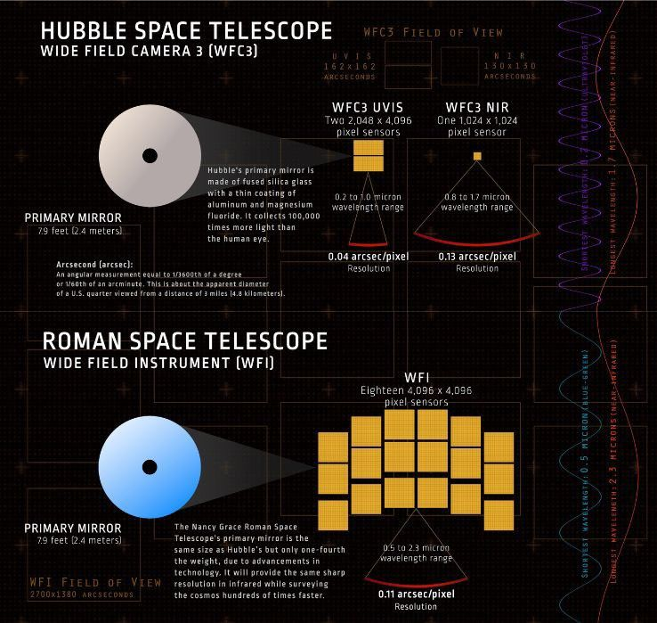

# 罗曼望远镜比哈勃强200倍，系外行星或从6000颗飙至20万颗

> 罗曼望远镜视场百倍于哈勃，5年巡天超哈勃30年总和50倍，或将系外行星候选从6000推至20万。

罗曼望远镜视场百倍于哈勃，5年巡天超哈勃30年总和50倍，或将系外行星候选从6000推至20万。

## 核心看点

NASA’s Nancy Grace Roman Space Telescope will create enormous cosmic panoramas, which astronomers will use to explore everything from dark energy and dark matter to distant planets and black holes. The first observations will start in early 2027. It is launched and is moving to position.

Roman will collect light from far across the universe using a primary mirror that’s 7.9 feet (2.4 meters) wide — the same size as Hubble’s primary mirror. Roman’s images will have the same crisp resolution as Hubble’s, but each one will capture a patch of the sky at least 100 times larger. Over the first five years of observations, Roman will image more than 50 times as much sky as Hubble covered in 30 years.​

It will either give better measurements of dark energy or it could disprove it. Dark energy / c...

## 延伸

NextBigFuture 原文提供了更多背景与数据，更多细节以原文为准。文末以画面感收束：当数据与算力持续堆高，下一波突破已在路上。
