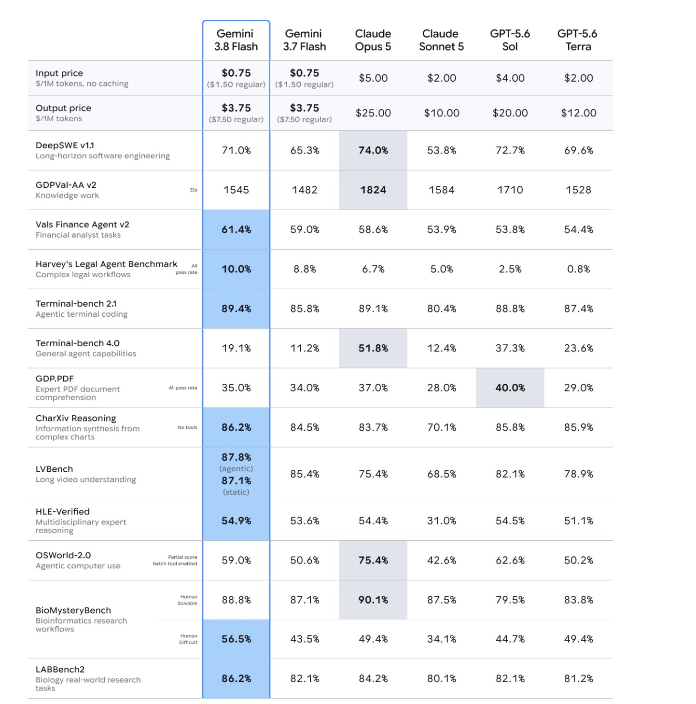

# 谷歌Gemini 3.8 Flash基准多项提升

> Gemini 3.8 Flash在多项基准上提升，尝鲜价0.75/3.75美元，速度与成本占优但硬核基准仍落后顶级模型。

Gemini 3.8 Flash在多项基准上提升，尝鲜价0.75/3.75美元，速度与成本占优但硬核基准仍落后顶级模型。

## 核心看点

Gemini 3.8 Flash is Google’s newest Flash-tier model released September 2, 2026. It is the most capable Flash model yet for mid-difficulty long-horizon software engineering, autonomous agents, and enterprise workflows, while keeping Flash-level speed and the same introductory pricing as 3.7 Flash. It is a value model.

Introductory (through Dec 31, 2026): $0.75 / 1M input, $3.75 / 1M output
Regular (from Jan 1, 2027): $1.50 / $7.50

Where it is strong
Vals Finance Agent v2 — 61.4% (best)
Harvey’s Legal Agent Benchmark — 10.0% (best. all models score poorly here)
Terminal-bench 2.1 — 89.4% (narrowly best)
CharXiv Reasoning (charts, no tools) — 86.2% (best)
LVBench long video — 87.8% agentic / 87.1% static (best)
HLE-Verified — 54.9% (best)
BioMysteryBench (Human Difficult) — 56.5% (best)
LA...

## 延伸

NextBigFuture 原文提供了更多背景与数据，更多细节以原文为准。文末以画面感收束：当数据与算力持续堆高，下一波突破已在路上。
