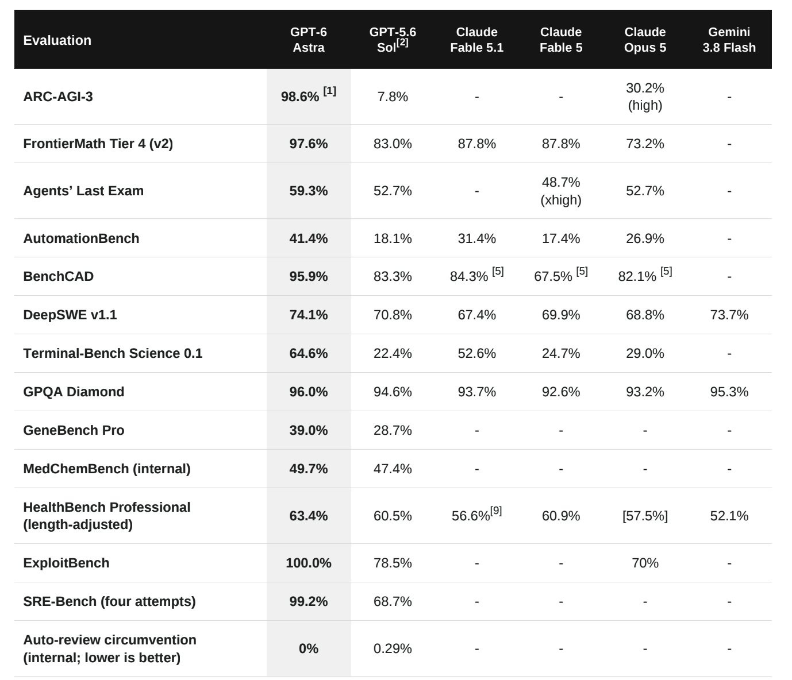

# GPT-6 Astra小范围领先Fable 5.1

> Brian Wang汇总：GPT-6 Astra在可比基准上全面领先Fable 5.1——ARC-AGI-3达98.6%、FrontierMath Tier4 97.6%、BenchCAD 95.9%、ExploitBench 100%，但为小范围灰度发布

GPT-6 Astra基准全面领先Fable

## 领先的基准

Astra在多项硬核基准上压过Fable 5.1与Opus 5：ARC-AGI-3 98.6%对30.2%，FrontierMath Tier4 97.6%对87.8%，AutomationBench 41.4%对31.4%，Terminal-Bench Science 64.6%对52.6%，BenchCAD 95.9%对84.3%，ExploitBench 100%对70%，Agents' Last Exam 59.3%对52.7%，DeepSWE 74.1%对67.4%，GPQA Diamond 96.0%对93.7%。

## 小范围发布

作者强调为“Limited Release”，对比均在可比集上进行，部分Fable模型缺测。Astra的领先是否能在全量与生产环境中保持，仍待更大范围验证。

基准的胜利只是入场券，真正的考验在工具链与代理化落地。
