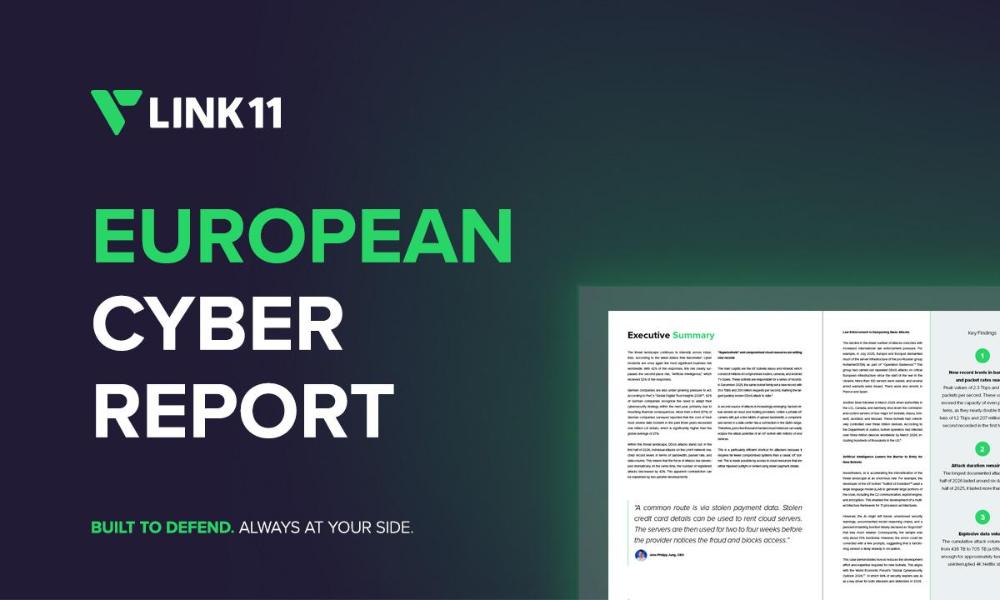

# Link11 欧洲半年报：攻击量少42%但威力创纪录

> DDoS总量下降但峰值创纪录：2.3Tbps与3.22亿pps刷新欧洲纪录，超级僵尸网络与劫持流成为新常态。

DDoS总量下降但峰值创纪录：2.3Tbps与3.22亿pps刷新欧洲纪录，超级僵尸网络与劫持流成为新常态。

## 核心看点

Frankfurt am Main, Deutschland, September 3rd, 2026, CyberNewswire

Super-botnets and hijacked cloud servers drive new bandwidth and packet-rate records as international law-enforcement pressure pushes attack counts down

Link11 has released its European Cyber Report for the first half of 2026, providing an overview of DDoS attack activity targeting European companies. Although the number of DDoS attacks on the Link11 network decreased by 42 percent, the report records new highs for attack intensity across bandwidth, packet rate and cumulative data volume, indicating that attacks have become more targeted and intense.

New Records for Bandwidth, Packet Rate, and Data Volume

Although the number of attacks decreased by 42 percent, record highs were reached in terms of attack intensity in ev...

## 延伸

NextBigFuture 原文提供了更多背景与数据，更多细节以原文为准。文末以画面感收束：当数据与算力持续堆高，下一波突破已在路上。
