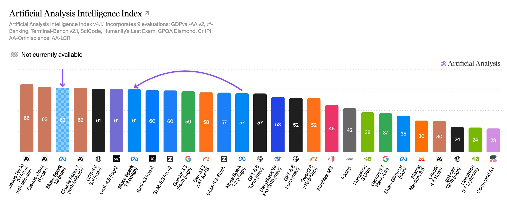

# Meta Muse被称有竞争力AI模型

> Meta发布Muse被描述为有竞争力的AI模型，但原文仅为标题党式短帖，细节待实证。

Meta发布Muse被描述为有竞争力的AI模型，但原文仅为标题党式短帖，细节待实证。

## 核心看点

Google has released Gemini 3.8 Flash, its fourth Flash model in under four months – it scores 59 on the Artificial Analysis Intelligence Index and reaches the Intelligence vs. Cost per Task Pareto frontier

Known for identifying cutting edge technologies, he is currently a Co-Founder of a startup and fundraiser for high potential early-stage companies. He is the Head of Research for Allocations for deep technology investments and an Angel Investor at Space Angels.

A frequent speaker at corporations, he has been a TEDx speaker, a Singularity University speaker and guest at numerous interviews for radio and podcasts.  He is open to public speaking and advising engagements....

## 延伸

NextBigFuture 原文提供了更多背景与数据，更多细节以原文为准。文末以画面感收束：当数据与算力持续堆高，下一波突破已在路上。
