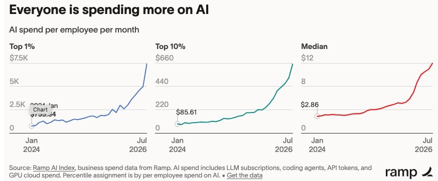

# 仅1%的AI用户贡献80%收入与用量

> 1%企业与开发者贡献80%收入与用量，头部人均支出为中位数600倍，AI使用高度集中。

1%企业与开发者贡献80%收入与用量，头部人均支出为中位数600倍，AI使用高度集中。

## 核心看点

1% of companies generate 80% of OpenAI and Anthropic’s enterprise revenue. The top 1% of firms spend about 600x per employee what the median firm spends.

Among individual developers, the top 1% write 46x more AI-generated code per day than the median user and merge 15x more pull requests.

A small group of agentic power users — often senior engineers running multiple AI agents at once — produce a wildly outsized share of commits.

These people mostly work at the Hyperscalers (Meta, Google, Microsoft, Amazon). They are big spenders because they have huge engineering headcounts, but they’re not uniquely intense users.

A senior engineer at a 20-person startup can out-produce a typical big-company engineer.

The heaviest users show up everywhere — inside Meta and Google, but also at Stripe, ...

## 延伸

NextBigFuture 原文提供了更多背景与数据，更多细节以原文为准。文末以画面感收束：当数据与算力持续堆高，下一波突破已在路上。
