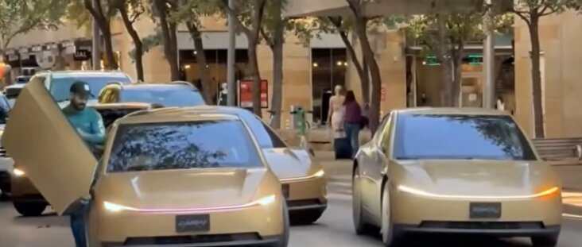

# 特斯拉Robotaxi德州注册达420辆直追Waymo

> 特斯拉在德州自动驾驶运营注册达420辆，24小时新增106辆，已升至全州第二逼近Waymo。

特斯拉在德州自动驾驶运营注册达420辆，24小时新增106辆，已升至全州第二逼近Waymo。

## 核心看点

106 Model Ys were registered in Texas for Tesla robotaxi in about 24 hours, bringing the total to 375 Model Ys and 45 Cybercabs as of September 2, more than doubling the count from the prior week. Trackers like Texas Autonomous Vehicle Tracker confirmed the number after the final Model Y registration, with Tesla now ranking second in the state behind Waymo’s 988 vehicles. There are now 420 total registrations for automated operation in Austin, Dallas, and Houston.

Known for identifying cutting edge technologies, he is currently a Co-Founder of a startup and fundraiser for high potential early-stage companies. He is the Head of Research for Allocations for deep technology investments and an Angel Investor at Space Angels.

A frequent speaker at corporations, he has been a TEDx speaker, a S...

## 延伸

NextBigFuture 原文提供了更多背景与数据，更多细节以原文为准。文末以画面感收束：当数据与算力持续堆高，下一波突破已在路上。
