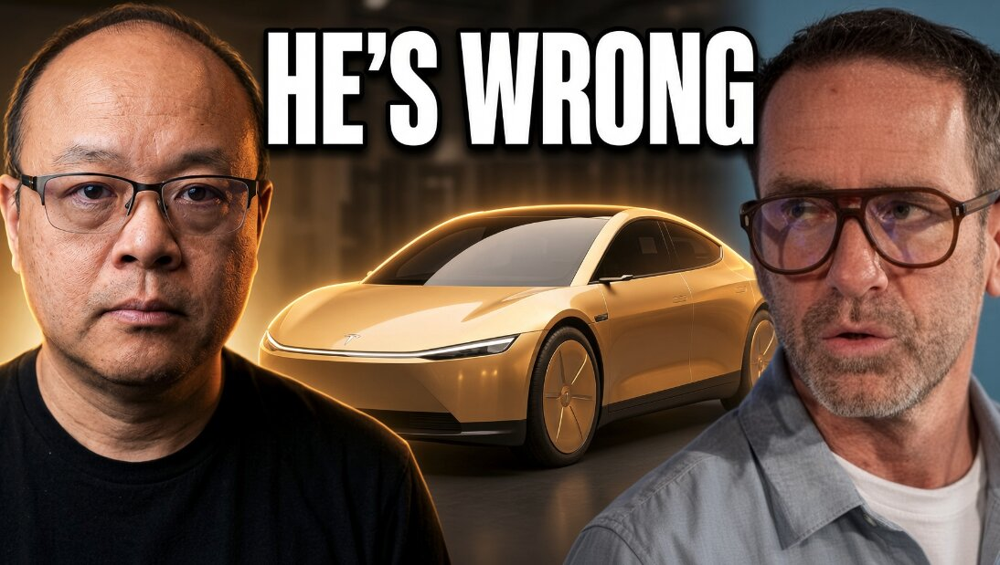

# 反驳Chris Camillo：特斯拉Cybercab的故事根本没有被市场price in

> 针对投资人Chris Camillo"特斯拉Robotaxi与Cybercab已被市场price in"的观点，作者在白板上逐条核算数字反驳：FSD订阅、600多万辆Hardware 4老车队、Cybercab单台经济学都没算进去，市场仍低估特斯拉。

反驳Chris Camillo：Cybercab还没被price in

## 争论焦点

曾在投资上把小额本金做到过1亿美元的Chris Camillo，近来判断特斯拉的Robotaxi与Cybercab故事"已经price in"（已反映在股价里）。Brian Wang不认同——他在视频里挂出白板，用逐条数字说明这位投资人实际上是"漏掉了好几层"。

作者的立场很克制：并不认为Chris全错，**"部分的story确实已经price in，但我们不同意的是它被price in了多少。"**

## 视频梳理的核心论据

这期是讲解视频，作者分章节拆解，核心落在这几个层面：

- **FSD订阅收入**：当前特斯拉已有FSD订阅现金流入，作者拿来对标Waymo的Robotaxi收入——这是当下就在发生的现金流，而非远期想象。
- **硬件回本的节奏**：特斯拉把FSD硬件成本赚回来的速度，是判断这套模式是否成立的关键变量。
- **被"没人算进去"的600多万辆Hardware 4老车队**：搭载Hardware 4的存量特斯拉车队规模超600万辆，作者认为市场还没把这条存量变现路径计入估值。
- **Cybercab单台经济学**：Cybercab单车成本约3万至5万美元，作者强调要区分毛利润与净利润——单位经济模型是Robotaxi规模化能否赚钱的根本。

## 被错过的总收入与最终估值

作者指出市场仍没纳入三块资产：**FSD存量车队、Hardware 4的变现能力，以及AI5/半导体业务**。如果FSD与Robotaxi真的被彻底搞定，按他的测算，特斯拉的营收与利润会快速放量——**到2027年底利润能达到200亿美元以上，2029年更超过2000亿美元**。

按这个利润推演，对应的是一个**10万亿美元以上的估值**；一旦确定性出现，折现后也会落在**5万亿美元或更高**。换句话说，眼前的"Robotaxi期权"远没有被充分定价。

## 其余盘面

除了Robotaxi主线，作者还顺带点出特斯拉的后续台阶：Optimus机器人、Semi卡车、AI5芯片等，作为"下一个增长腿"（next leg up）——这些才算得上真正还没被price in的部分，也解释了为什么他觉得相对Chris的保守判断，市场其实仍然留有巨大的想象空间。
