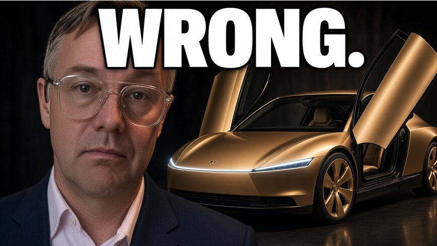

# 反驳Jason Calcanis：特斯拉为何可能吃下99%到100%的Robotaxi市场

> All-in播客的Jason Calcanis预测未来Robotaxi市场特斯拉占40%、优步占40%、Waymo占15%、其他人分剩下的5%。作者Brian Wang用白板核算供应链、单车经济学和硬件数字，认为这个分法与事实相去甚远——特斯拉很可能最终吃下99%到100%的市场。

反驳Jason Calcanis：Robotaxi之争为何可能一边倒

## 争论的分歧点

这期是白板讲解视频。Jason Calcanis在All-in播客里的预测是：特斯拉40%、优步40%、Waymo 15%，剩下5%给其他玩家。作者不否认Waymo、优步和中国自动驾驶公司都是真实生意、有真实部署，**分歧出在规模数学、时机、爬坡速度、商业模式、工厂、激光雷达供应链和单车经济学上**——这些维度全都指向特斯拉一骑绝尘，而非三足鼎立。

## Waymo的激光雷达供应链瓶颈

首先是Waymo。作者指出Waymo的车队规模约4000辆，但真正卡脖子的是工厂产能与**robotaxi级别的激光雷达短缺**——Waymo现在每天只能转化不到10辆车。全球激光雷达的供给总量大约也就支撑1万辆左右的robotaxi，**到2030年前后这个供应链上限也就是2.5万到5万辆**。也就是说，激光雷达物理上供不上Waymo想要的规模放量。

## 优步的钱从哪来、又押在哪

再看优步。作者算了一笔单量细账：**你花25美元打一趟车，真正落到优步手里的只有约5美元**——它做的是撮合与调度，资产和运力都不是自己的。优步的Robotaxi对冲是把约100亿美元押在20家自动驾驶伙伴上，但这些伙伴仍高度依赖激光雷达路线；而在需求侧，优步真正的Plan B竟然是**直接向特斯拉买Cybercab**——这本身就说明它手里没有自己的运力底牌。

## 特斯拉的硬件翻转时刻

特斯拉这边则是另一套逻辑。作者给出的核心数字：**已有600万辆搭载Hardware 4的特斯拉在街上跑、且具备Robotaxi条件**，今天更有超过150万辆在跑\"受监督的FSD\"。这意味着不必新造一辆车，一次FSD软件更新就能在一天之内把整个存量车队变成无人驾驶网络——**当FSD 15.X更新上线后，能直接解锁600多万辆特斯拉的无人驾驶**，这是任何对手都得先花几年造车才能追上的存量。

## 为什么最终可能是99%到100%特斯拉

把这三家放到规模尺度上一比：Waymo被激光雷达卡住产能，优步没有自己的运力只能靠采购与调度，而特斯拉既有存量硬件可软件一把翻转，又有垂直整合的工厂、还能继续扩建的充电网络。因此作者认为，最终的格局不是四六开或三足鼎立，**而是特斯拉单极吃下99%到100%的市场份额**。

（原文为白板讲解视频，正文以作者口播的章节梳理为主，以上为节选整理。）
