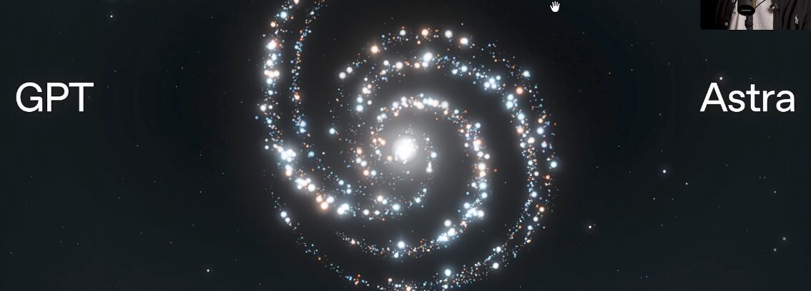

# 聊聊OpenAI Astra、GPT-6与AGI

> 作者放出新帖预告OpenAI话题，正文只留一句话——GPT-6是下一代模型、"打造方式不一样"，Theo称其为史上最强模型，正文尚未展开。

聊聊OpenAI Astra、GPT-6与AGI

## 只有一句话的预告帖

这则NextBigFuture的帖子更像一个话题引子：作者挂出相关截图后，正文只有一句断言——**OpenAI GPT-6是下一代模型，它"built different"（打造方式不一样），而Theo评价它是史上最好的模型。**

## 作者身份说明

Theo 以挖掘前沿科技著称，目前是一家初创公司的联合创始人、高潜力早期项目募资人，同时在深科技投资机构 Allocations 担任研究院主管，并是 Space Angels 的天使投资人。他常在大型企业演讲，曾任 TEDx 演讲者、奇点大学（Singularity University）讲师，多次做客广播和播客访谈，也接受公开演讲与合作邀约。

## 等待正文展开

眼下这则帖子只有剧透式的一句话，关于Astra、GPT-6与AGI的具体细节尚未成文。相比OpenAI是否临近发布GPT-6、Astra的定位以及AGI临界点等宏大命题，读者还得等Brian Wang把正文补全后再看完整叙事。
