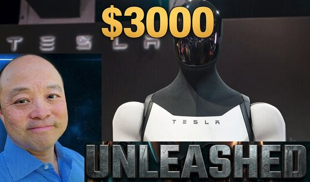

# 特斯拉据供应链确认今年造1.5万台Optimus 股价看至3000美元

> 据界面新闻与供应链供应商透露，特斯拉已向供应商下单足够今年底前造出1.5万台Optimus人形机器人的零部件——9月底约每周1000台、年底爬坡到每周2500台，换算成2027年年化产能是10万到12.5万台。作者称这批节奏比几乎所有人的预期都快，据此把特斯拉目标价看到每股3000美元。

特斯拉据供应链确认今年造1.5万台Optimus

## 首笔量产订单落地

这期是讲解视频。好消息来自供应链与今天的界面新闻报道：**特斯拉已经发出了约为5000台Optimus机器人的首批订单**。此前特斯拉只做过几百台的试点产线，这是Optimus项目第一次进入正式量产下单阶段——从\"试跑\"跨到\"排产\"。

更具体的时间表是：特斯拉向供应商下的零部件订单，足以**在2026年底前造出1.5万台Optimus**。按爬坡节奏推算，**9月底达到每周约1000台，到年底拉高到每周2500台**——换算成2027年的年化产能，就是**每年10万到12.5万台**。

## 为什么这波爬坡比几乎所有人预测都快

作者强调，这个速度超出了绝大多数人的预期，也**证实了一个许多人怀疑过的判断：人形机器人的规模化生产正在发生，而不是几年之后才来**。

他认为Optimus放量会比汽车快得多。汽车从设计到产线有天量的供应链和模具约束，而机器人可以借助特斯拉已有的工厂和自动化经验快速复制；更重要的是特斯拉这套**Optimus Academy学习闭环**——只要一台机器人学会一项任务，整个车队就都学会了，车队越大，单个任务的学习成本就被摊得越薄。

## 作者预测的后续看点

视频还给出几个判断：特斯拉几乎肯定会在**10月底或9月下旬**的公开活动里，展示Optimus在真实工厂里干活（焊接、装配、线束）；而特斯拉已经没有理由再藏着掖着——**中国供应商手里已经有了这些零部件**。

另一个有趣的角度是Cybercab的\"unbox\"（拆装式）生产流程：作者认为Optimus能像当年上海工厂靠更低的人工成本让Model 3/Model Y产量接近翻倍那样，把Cybercab产量再翻一番。

## 更新后的估值：每股3000美元

最后是更新过的估值测算。作者给出**2026年底的600到800美元**目标价，并把**2027年底每股3000美元**的目标价折现回今天。3000美元意味着从现价大约7倍的空间、对应**10.5万亿美元市值**——与SpaceX那座10GW AI数据中心约10万亿美元的估值规模大致相当。对作者而言，Optimus跑到这个产能，甚至可能比Cybercab是更大的新闻。

（原文为视频文章，正文以作者逐章节口播为主，以上为节选整理。）
