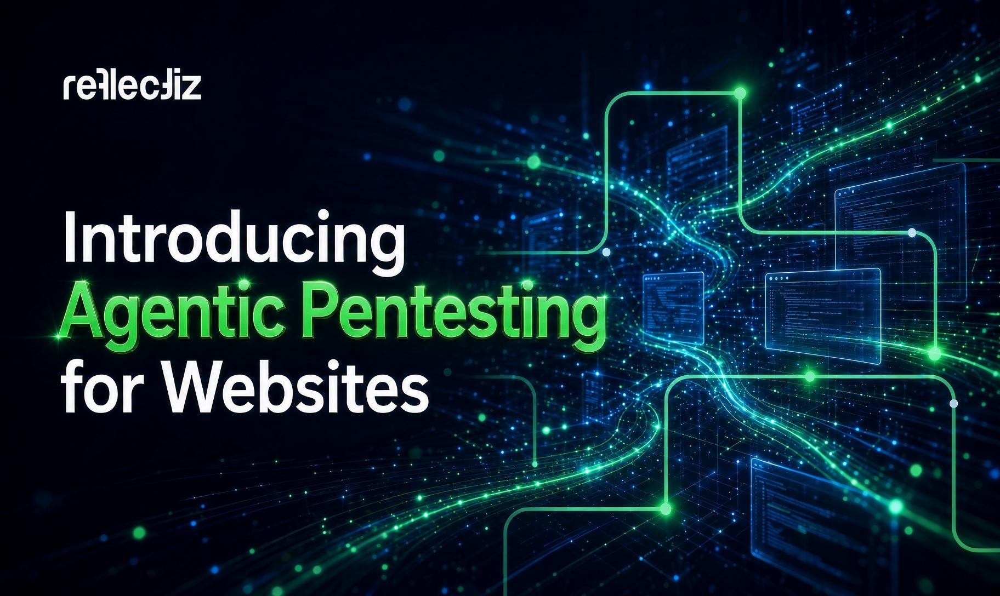

# Reflectiz发布代理式渗透测试平台 覆盖能力比传统高10倍

> 连续网站暴露管理公司Reflectiz推出多代理渗透测试平台：一组专门化的AI代理负责发现、攻击并验证Web漏洞，由于从每个站点已有的模型出发，覆盖范围比传统渗透测试工具高出最多10倍。

Reflectiz：让渗透测试跟着网站每周的变化跑

## 从\"一次事件\"到\"持续跟上变化\"

在Reflectiz看来，渗透测试过去是一件\"一次性的事\"：一个项目、一份报告，做完就算结束。但那份报告描述的只是某个时点的状态，网站却一直在变——登录、结账、支付、几十个第三方脚本，每天都在被攻击者试探。

**\"网站每周都在变，却每年只被渗透测试一到两次，暴露面就是在这个空档里积累起来的。\"**——Reflectiz联合创始人兼CEO Idan Cohen说。团队需要的，是能以可持续成本跟上版本迭代的测试，以及对\"到底测了什么\"有可信的覆盖。

## 十年攒下的\"活模型\"

别人的测试每次都从零开始、对目标一片空白，Reflectiz的优势在于\"已经认识这个网站\"。十年间Reflectiz扫描过数千个生产环境网站，手里保存着每个站点的实时模型：页面、脚本、第三方、域名、敏感输入和行为特征。**这次发布的代理式渗透测试，就是把攻击者的视角叠加到同一个模型上**。

联合创始人兼CTO Ysrael Gurt点破关键：**\"Web渗透测试的难点从来不是payload（攻击载荷），而是搞清楚应用到底在干什么。我们的引擎读活网站读了多年，所以代理一开始就有一张其他工具永远不会构建的站点地图。\"**

## 一组专门代理，而不是又一个扫描器

代理式渗透测试以一组分工明确的AI代理协作运行，每个代理有各自的角色。一条漏洞发现不再只是一个孤立条目，而是连同**它涉及的脚本、它能触达的数据、以及此刻是否有真实用户正暴露其中**一起交付——团队可以跳过排查环节，直接进入修复。

测试覆盖完整的OWASP Top 10，团队还能按不同的流程设置测试深度，从快速预设检查到关键资产上的专家级攻击链。由于深耕既有站点上下文，这套方案得以**大幅降噪、加快修复闭环**，覆盖范围达到传统渗透测试工具的最高10倍。

## 补齐360度Web风险地图

这项代理式渗透测试隶属于新推出的Offensive Hub（攻击中心），与Reflectiz平台已有的Security Hub（安全中心）和Privacy Hub（隐私中心）并列，共同拼出关于Web风险的360度全景：网站上跑着什么、它触达什么数据、以及它如何可能被攻击。

Reflectiz自称\"无代理、由外而内\"的连续Web暴露管理公司，服务零售、金融、旅游、保险、医疗和游戏等行业，帮助企业在不碰一行代码的情况下满足PCI DSS、DORA、NIS2等全球合规要求。两位创始人Idan Cohen与Ysrael Gurt将于**9月15日上午11点（美国东部时间）/下午6点（欧洲中部时间）**以线上研讨会形式实操演示这套代理式渗透测试。
