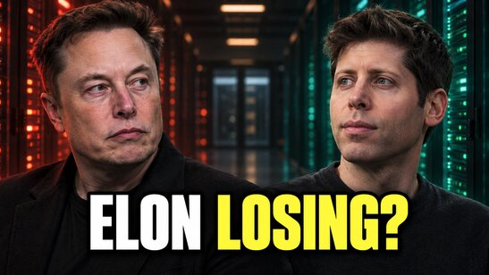

# 黄仁勋称AGI已到来 未来几个月是关键

> 黄仁勋公开表示AGI已经到来。NextBigFuture作者Brian Wang在视频中谈自己把AI订阅从每月20美元提到200美元，并逐一拆解GPT-6 Astra、Claude Fable、Grok的竞争格局，以及B300、Rubin带来的下一轮算力扩张。

视频封面：AGI已到来，未来几个月是关键

## AGI已到来，你的优势在哪

黄仁勋的态度很直接：AGI已经来了。这不是遥远的路线图，而是眼下的现实——问题只剩一个：你拿它来做什么？

在NextBigFuture的这期视频里，作者Brian Wang把视角从"AGI何时到来"拉回到"个人怎么用"。他坦承自己把每月AI相关订阅从20美元一路加到200美元，十倍的开销换来的不是收藏更多模型，而是把过去一直拖延的工作真正做完。

## 模型竞赛：GPT-6、Fable与Grok

视频用相当的篇幅梳理当前模型竞争格局：OpenAI的GPT-6 Astra、Anthropic的Claude Fable，以及xAI的Grok，三家贴身肉搏。它们不再只是比聊天手感，而是比谁能把任务真正跑完、跑得可靠——谁能在同一价格下交付更完整的"成品"。

## 一个任务到底值多少钱

作者抛出一个实用问题：完成一个任务要花多少钱？当模型每月涨价十倍，判断标准就不该是"哪个模型更聪明"，而是"这个任务交给它值不值"——把AI花在产出可衡量价值的工作上，而不是让它替你写没人在乎的废话。

## B300、Rubin与下一轮算力扩张

算力扩张是这期视频的另一条主线：英伟达B300之后，Rubin平台接棒，数据中心建设仍在加速。更猛的算力意味着什么？不是排行榜上多几个百分点的分数，而是模型能在更长时间内保持高质量输出——这正是代理（agent）能力变强的底层燃料。

## 更可靠的代理，更长的任务

视频后半段讨论代理能力的拐点：当AI不仅能答对问题，还能可靠地执行多步骤、跨时长的任务，工作流的形态会变。作者认为，对个人和公司来说，最值得押注的是把那些"你早就想做完但一直拖着"的活，整理成可以交给代理的清单。

## 你的个人AGI从哪开始

Brian Wang的结论朴素：个人AGI的起点不是追新模型，而是从你本来就重视的工作出发——什么能做得更好？什么能交出去？什么终于能收尾？

视频也预告了后续选题：算力扩张、AI数据中心与特斯拉/SpaceX的建设进度都会持续跟进。对普通用户而言，窗口期就在未来几个月——先想清楚自己要代理什么，比纠结订阅哪家更重要。