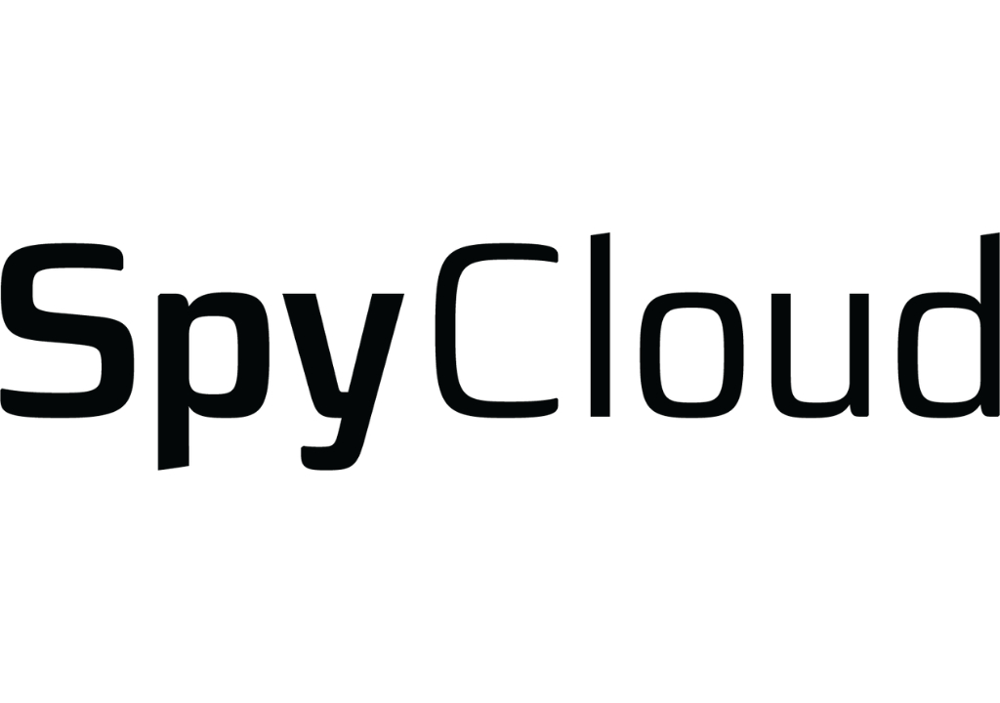

# SpyCloud年度身份威胁报告：非人类身份成入侵企业头号路径

> 身份威胁防护公司SpyCloud发布年度报告：尽管95%的组织声称自己看得见AI与机器身份暴露，真正在监控的只有36%；被攻破的非人类身份（NHI）如今已成为入侵企业最常被利用的路径。

SpyCloud《2026身份威胁报告》：机器身份暴露是安全"盲区"

## 95%声称看得见，只有36%真在盯

SpyCloud于9月9日发布《2026身份威胁报告》，这份基于问卷调查的研究指出，非人类身份（NHIs）——包括连接内部系统的AI代理、服务账号、API密钥和身份验证令牌——已成为攻击者入侵企业最常用的路径。

数据揭示了一个巨大的"自信缺口"：**95%的组织认为自己能看清AI和机器身份暴露，但实际在监控它们的只有36%**，机器身份也因此成为整份报告中监控度最低的一类身份风险。

## 被攻破的机器身份几乎是钓鱼的两倍

调查显示，**被攻破的NHI（占31%）作为主要入侵入口的概率，几乎是钓鱼和社会工程（占17%，排名第二）的两倍**。与NHI相关的滥用也是最常被报告的身份事件类型，占比高达42%。然而绝大多数组织并没有盯着它们。

问题还在进一步放大：同一时期内有68%的组织遭遇了至少一次身份事件，受影响者平均每家发生了8起事件。

## 服务账号没人"认领"，暴露后能潜伏数月

大多数组织对员工已建立清晰的台账，却很少把同样的可见性延伸到每天接入系统的服务账号、API密钥和AI代理。这些身份为方便而配置，往往握有真实权限，但多数环境里根本没人负责它们：**服务账号不会被停用、不会自动轮换凭据、也不会被MFA质询拦下，一旦暴露，可能持续可用数月之久**。

SpyCloud首席情报官Trevor Hilligoss点出了攻击者利用的核心：这种不对称正是攻击者在利用的东西，"这些身份中的每一个都等于一份会自我续期的常驻邀请函，直到有人注意到为止。"

## 自动化程度，决定事件代价

日常工作依赖手动逐个修复的组织，比起自动化程度较高的组织，报告了更高的应急成本（39%对32%），也承受了更大的客户或合作伙伴信任损失（47%对36%）。

报告还引入SpyCloud的身份威胁防护成熟度模型，把受访者分成四档——被动、建设、运营、优化——横跨暴露可见性、监控、治理、自动化与修复。结果显示：身份管理越成熟，越依赖持续监控与自动化修复，而正是这套组合真正压低了事件发生率。

首席产品官Damon Fleury直言，多数身份管理还停在"有没有发生暴露"这个评判维度，"那是错的记分牌"，把持续监控与自动化修复结合起来的组织，才是给罪犯制造最大障碍、最能在后续攻击链中占上风的一方。

## 样本与背景

这份报告基于对北美（美加）、英国以及西班牙、德国、荷兰、奥地利、瑞士等欧洲部分市场的750位网络安全负责人与实践者的调查，样本来自员工数超过500人的组织，针对人类与非人类身份在检测、修复与治理层面的表现进行基准比对。

总部位于奥斯汀的SpyCloud将抓回的暗网数据转化为防护能力，客户覆盖《财富》10强中的7家，以及数百家全球企业、中型公司与政府机构，旗下拥有超过250名网络安全专家。