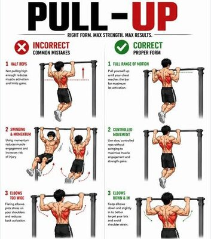

# 60岁终于做成引体向上 作者分享训练心得

> 60岁的NextBigFuture作者布莱恩·王（Brian Wang）第一次在自己的人生里做成引体向上——一次能做4个，他复盘了从错误发力到背部发力的漫长纠正过程。

引体向上训练——作者60岁时终于完成人生第一批标准动作。

## 人生第一次做成引体向上

作者晒出成绩：他终于能用中立握把一次做4个引体向上了，这是他这辈子第一次做成任何引体向上的动作。往前回想，二三十岁时他力量更强、体重更轻，却一直做不起来，根源在技术——他坦白，当年自己只会拼命用手臂硬拉，压根没把背用进去。

找回背—肩发力被证明是最难的一关。他花了大量时间只练起始阶段的肌肉募集和时机配合。多年来他几乎不练背部和肩胛肌群，最后还是借YouTube视频慢慢开窍的。

## 减重配合专项训练

与此同时，这一年他一边控制饮食一边做重量训练，减掉约10磅，体重从刚过200磅降到190磅。他说，若还保有二三十岁的底子，大约能到165至170磅，且肌肉更多、脂肪更少。眼下他的目标是几个月内先压到180磅，同时保住肌肉、继续加力量。

前几个月的专项动作是悬垂：从30秒然后练到1分钟，同时反复练习肩背发力。他说自己的短板在于握力、背部力量，以及在正确时机让背和肩介入。悬垂练下来，握力和耐力都上去了，这才让他有足够的时间空间完成动作。

## 练到力竭 建身心联结

作者还提到一个近期新增的变化：开始把每组真正练到力竭。练得更狠反而让力量涨得更快，也建立了更强的身心联结，让呼吸、专注、神经系统和肌肉的放电协调起来。

按这个进度他预估：技术再顺一些、背肩多练、家里引体向上杆多练，过几周就能做6个，圣诞节前有可能磨到8到10个。