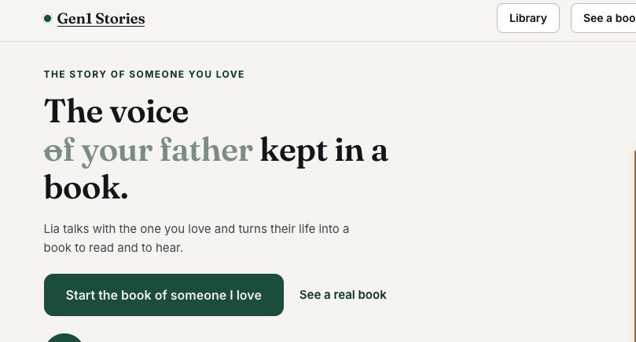

# 让记录祖父母生平故事变得简单 别等亲人走了才后悔

> 大多数家庭都是等到亲人离开、只剩几段零星轶事和一盒没贴标签的老照片，才后悔没能趁人还在时问清祖父母的故事——如今有人专门做这件事。

记录祖父母生平故事的订阅服务——一周一个问题，攒满一年装订成精装书。

## 别等亲人走了才去问

很多家庭都会在同一个时间点后悔：其实早就想多了解祖父母，想让故事里的人还坐在房间里时就把故事录下来。可往往等老人走了，剩下的只有三则轶事和一盒没有标签的照片。

作者强调，这件事的意义不在于做出一本更漂亮的纪念册，而在于真正了解他们，也让孩子们知道自己从哪里来。想记住一个人，就得趁对方还能讲述时，把那些故事从他们脑子里取出来。

## AI把记录成本降到几乎为零

为这段话点题的是彼得·戴曼迪斯（Peter Diamandis）。他在领英上写道：一个大语言模型在晚饭前就能生成一百个故事，而产出单个故事的成本已经降到几乎为零——问题只剩下一个，你能不能拿到上一辈人的故事。何况他们手里往往还有父辈、叔伯和祖辈的第一手见闻。

## 一周一问 攒满一年装订成书

Gen1 把这一套环节做了专业化：每周通过邮件或短信推送一个问题，家人用打字回答，更高档的服务还能用电话录音。攒上大约一年，公司会装订成一本精装书。套餐眼下从大约 59 美元起步，常见套餐接近 99 美元，还有彩色内页、专人电话引导等升级选项。十年下来积攒了大量用户评价，而且它最终交付的是实实在在可以摆上书架的东西。

赶在这个节日周，官方还放出了优惠：美国东部时间 9 月 13 日中午 12 点前，用优惠码 NEXTBIG15 下单可享 85 折。