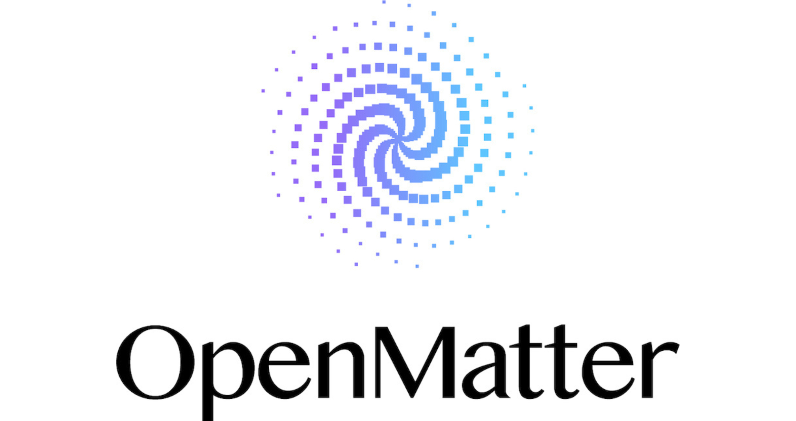

# OpenMatter Networks调整管理层 加速全球商业增长

> 佛州墨尔本的OpenMatter Networks宣布调整管理层，在其Verification Architecture平台商业化并持续增加新能力之际，瞄准订阅增长、行业伙伴与长期商业落地。

OpenMatter Networks管理层调整——平台从首发进入商业化与全球扩张的新阶段。

## 管理层调整与人事变动

这份发布在弗罗里达州墨尔本的新闻稿（CyberNewswire 9月10日）称，随着Verification Architecture平台进入商用并不断扩展能力，OpenMatter Networks宣布对管理层进行战略性重组，目的是加速订阅增长、扩大行业合作，并为长期商业成功做好准备。

自9月1日起，Mike Anderson出任OpenMatter Networks CEO，同时继续担任CFO；此前带领公司走过平台开发与商用发布全过程的Renee Davis，转任首席商务官（Chief Business Officer），把重心直接放到商业化、订阅增长，以及让产品节奏贴合不断演变的市场需求上。Chris Biele升任运营与合作伙伴关系副总裁，负责扩展企业及技术伙伴网络、扩容内部基础设施，并确保各市场合规。

## 新组织的新分工

这次调整正值OpenMatter从首发走向以商业采纳与全球扩张为核心的新阶段。Anderson表示，团队在很短时间内完成了很多事——从搭建并推出OpenMatter Networks，到做出他们认为领先于市场趋势的平台。现在需要把领导层的才能对准眼前的机遇：Renee全心投入商业化，Chris专注于扩大伙伴与生态，而他本人则将精力放在支撑增长所需的财务、合规与组织地基上。

## 商业化与销售扩张在路上

作为首席商务官，Davis将牵头扩大订户基础，同时与客户和伙伴密切沟通，识别市场需求并引导平台持续演进。Biele的扩权同样是对其开发与发布OpenMatter贡献的肯定，新的职务更强调扩大网络、以及在安全计算、AI、区块链与密码学等领域和其他组织建立关系。

这一系列人事变动发生在此前平台的商业化首发以及多轮能力增强之后。OpenMatter的Verification Architecture旨在让组织用密码学证明取代基于假设的信任，同时提供可扩展的底座，以便随着计算演进继续纳入新技术与新能力。

OpenMatter还在组建一支覆盖全球的销售团队，以支撑下一阶段商业扩张，预计会在美国和欧洲增聘销售人才，加速推广基于订阅的OpenMatter Networks访问。Anderson总结：把人摆到适合当前成长阶段的位置，技术有了、平台已商用、能力还在扩展，接下来的任务就是搭好组织，把这些优势转化为可持续的全球商业成功。栏目信息与产品详情见官网 www.openmatter.network。