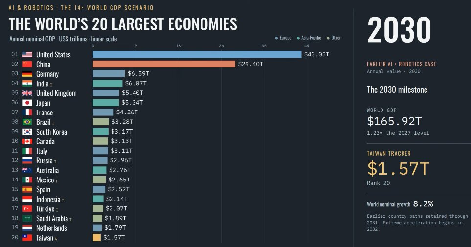

# 世界GDP预测2024到2037 国别分解

> NextBigFuture自己推出了一版2024到2037年的世界GDP情景预测：不是IMF、Anthropic或市场一致预期，而是在Anthropic基准与牛市两种情景基础上，叠加台湾等国今年最新数据，再用OpenAI的GPT6搭建AI生产力起飞加上robotaxi、robottrucking与人形机器人大爆发的世界。

世界GDP十年预测——2037年名义GDP被设定为2027年的14倍，跑出了惊人的30%复合增速。

## 一套自己的预测场景

作者明确标出，这是NextBigFuture自己的预测情景，不是任何官方数据。他采用Anthropic经济预测中的基准情形与牛市情形，再按今年口径对齐台湾等国的最新数据，接着用OpenAI GPT6搭出一套AI生产力腾飞、物理世界由robotaxi、robottrucking和人形机器人接管的推演。

为了让人对数字有体感，他给了两个历史参照：二战期间美国靠军事动员与生产，曾在约四年的时间里维持18%的年度GDP增长；中国在1980年到约2010年的二三十年里，保持过8%到14%的年度增长。

## 14倍不是14%

这里的14×是关键概念：它指2037年的世界名义GDP水平等于2027年的14倍——即增长1300%，而不是指14%的同比增速，也不是每年14倍的增长率。按此推演，世界GDP从2027年的134.63万亿美元一路涨到2037年的1884.80万亿美元，十年名义美元复合年增速高达30.20%。

一个被单独标注的点：台湾官方统计今年已经报出11.2%的GDP增长，靠台积电的强势，台湾已经是一只1万亿美元级的经济体，并有望在2027年迈向1.2万亿美元。

## 模型内的推演逻辑

在模型内部，作者保留了最初37国GDP路径与世界合计直到2031年的走势。要让2031年世界GDP保持在181.21万亿美元，那么2032到2037年这段必须扛起平均每年47.75%的名义增长——这取代了早先的中等情景延续，是一个激进得多的第二阶段。

需要澄清单位问题：现有图表衡量的是现价名义GDP，因此14×这个约束也在同一单位下成立，并不代表14倍的实体产出。从2032年起，2%的GDP平减指数和恒定汇率只是推算隐含实际增速时的可选会计假设，并非独立预测；若要达到14倍的实际产出，在物价上涨情形下需要更高的名义终点。

## 谁领先谁掉队

国别差异被量化成成长得分。美国因掌握前沿平台、模型变现、自动化与能源建设而领先；台湾靠先进逻辑、封装与生产自动化，韩国靠内存、机器人与工业落地，三者的对数成长得分分别是1.45、1.60与1.50，是模型中最强的三条路径——但作者强调这些是情景判断，不是实测分数。

新加坡、马来西亚、越南与印度受益于应用落地、服务业、电子与区域供应链；中国拥有强大的本土AI与制造生态，但按变现要求较弱的口径，得分低于领跑者们，且模型没有机械地把中国芯片产能受限的约束线性外推到2031年之后。

加拿大、澳大利亚、海湾国家、挪威和一些资源出口国，只在能源能转化为可靠电力、基础设施与本土增值的地方才跑赢最慢的采纳者——光拥有能源并不够。相比这个非同寻常的快世界，欧洲大陆整体增长偏慢；英国、荷兰、瑞士、爱尔兰与北欧的得分高于意大利、法国或德国。即便是偏慢的国家，绝对增速依然可观——落后者掉的是相对份额，不一定是绝对缩水。

文中还说明了数据来源：IMF序列沿用了原始项目的冻结数据，美国与加拿大用FRED和加拿大统计局提供的BEA口径作nowcast输入，台湾采用DGBAS（台湾主计总处）展望口径，2026年1.05万亿美元、2027年1.2万亿美元被标注为用户的固定锚点。