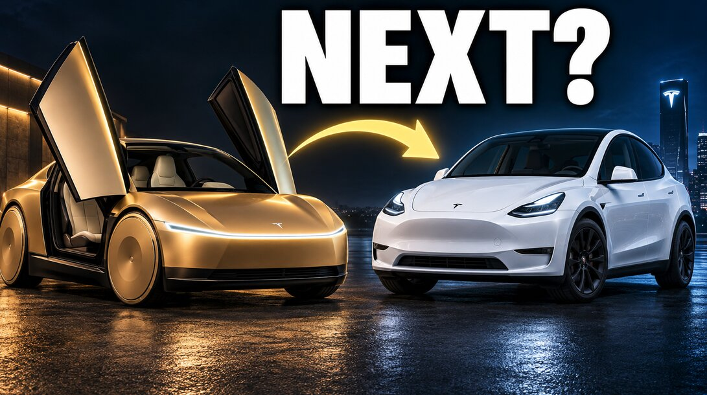

# 特斯拉如何从已卖出的车每年再赚50亿美元

> 车已经卖出去了，特斯拉还能不能靠着同一台车持续赚钱，甚至等车停在那儿的时候也在赚钱？作者拆出了三条未来的收入流：FSD订阅、自动驾驶出行和"数字Optimus"。

一辆停在车库里的特斯拉——停在车位的车也能成为持续创收的资产。

## 三条未来的收入流

特斯拉现有的或将来会有三条关于车辆的收入流：FSD（全自动驾驶）订阅、自动驾驶出行服务，以及"数字Optimus"——让AI用特斯拉的硬件来做基于电脑的工作。

市面上的注意力几乎都被Cybercab抢走，但作者指出，已经停在某户人家车库里的Model Y，同样可能成为特斯拉下一个增长故事的重要一环。

## 老车主回流 出行里程 数字Optimus

FSD的提升可以让老车主重新变回付费订阅用户，也吸引新买家入局；在评估自动驾驶出行业务时，不能只看车队规模，robotaxi的行驶里程和客单完成率同样关键；马斯克的"数字Optimus"构想、Grok在其中扮演的角色，以及它和Grok Bot、实体Optimus的区别，也被一并拆解。

## 算给读者看的经济账

作者在文中算了几笔账：一年1200美元的订阅费，六年的总价是7200美元，对照的是新车约7000美元的初始利润；如果100万台参与车辆每月为特斯拉贡献300美元，就相当于每年36亿美元的收入运行率。文中还推演了一种2027年底的上行情景，以及要吸引车主参与，这套经济账究竟划不划算。

需要说明的是，文中的财务数字都是示例性假设，并非特斯拉官方指引；订阅收入是毛收入，实际利润取决于毛利率，2027年底的例子描述的也只是潜在的年度运行率，而非2027全年真正赚到的钱。

文章最后抛给读者一个问题：你愿意让停在车库里的特斯拉去做付费的数字化工作吗？