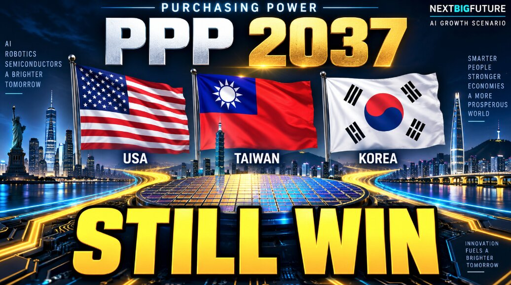

# AI与机器人驱动的全球GDP购买力平价预测

> 这份预测不是IMF、也不是传统市场共识——它把Anthropic对AI经济的基准与看涨情景，叠加OpenAI GPT 6搭建的机器人生产力起飞场景，推演出美国约在2034年重新夺回按购买力平价计算的全球GDP第一。

## 一份不讲共识的预测，从何而来

本期由NextBigFuture发布的GDP预测，刻意与IMF或市场普遍看法保持距离。它的推演路径分三步：先取Anthropic经济预测中的基准与看涨两种情形，再对齐台湾等经济体的今年实际数据，最后借助OpenAI GPT 6，构造出一个AI生产率全面起飞、同时robotaxi（自动驾驶出租车）、robotrucking（自动驾驶货运）与人形机器人集中放量的世界。

与此前版本不同，这一版改用购买力平价（PPP, Purchasing Power Parity）口径，而不再是名义汇率。口径的切换直接改变了各国排名的相对位置——不只看账面GDP数字，更看货币在一国之内实际能买到什么。

## 历史增速，怎样给预测兜底

预测并非凭空拍脑袋，两位历史参照撑起了它的想象空间。二战期间，美国依靠大规模军事动员，曾在一个约四年的周期里维持每年18%的GDP增速；中国则在1980年到约2010年的二三十年间，长期保持每年8%到14%的高速增长。这两段历史说明：在特定技术或政策驱动的节点，经济体完全可能跑赢常规曲线。

## 排名如何洗牌：美国重回第一，日韩被甩身后

按这套推演，全球GDP（PPP口径）的座次将明显重置。美国大约在2034年重新夺回全球第一的宝座；韩国和台湾的排位紧跟在中国与印度之后，且均领先于日本。曾经「亚洲四小龙」里领跑的日本，如今被这两位后起者反超，排位整体后移，意味深长。

## 变量主导未来

整份预测的核心变量，仍然是AI生产率能否真正兑现，以及robotaxi、robotrucking和人形机器人是否如期大规模落地。若这些技术按看涨情景推进，2034年的时间点就并不遥远——届时，衡量一个国家实力的标尺，也许已从人口与资源，悄然换成了算力、机器人与自动驾驶的车轮。