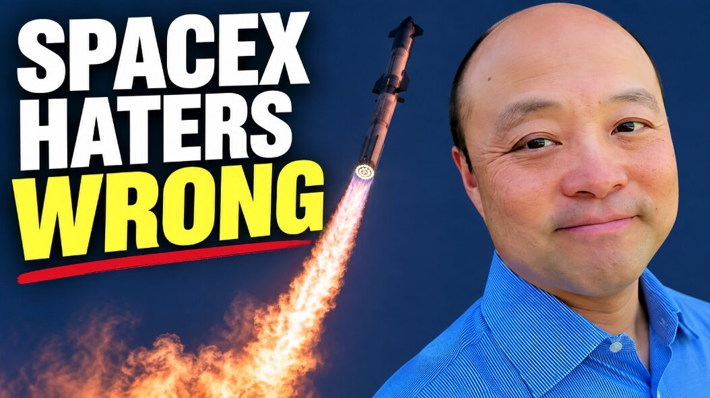

# 14个空头说辞：SpaceX怎么在150天里把公司讲成2万亿美元

> 一支倒计时视频逐条拆解了14条针对SpaceX的空头说辞，而它能讲得通的底气，全押在工程如何一路流进收入与利润：星舰商业载荷、助推器回收、发动机复用、AI算力托管，以及支撑到点的那句预测——到12月年化收入超过1200亿美元。

SpaceX下一次巨舰发射，以及改变世界的150天。

## 空头的14条说辞，为什么一条比一条经不起推敲

视频开场就把最尖锐的问题摆上台面：投资者到底有没有算对收入。它没有替SpaceX辩护，而是站在工程侧，把数据从发射台一路数到利润表。星舰能否带商业载荷入轨、助推器能不能活着回来、隔热罩会不会让复用泡汤、复用发射是不是永远便宜不下来、发动机够不够造——这五条是整场辩论的地基。

往后翻，争议从物理走向生意：可取消的AI合同算不算数、太空里跑AI到底赚不赚钱、Grok是不是必须做到全球最好SpaceX才能赢、是不是只有星链能挣钱、SpaceX是不是"只是一家火箭公司"。再加上三条节奏型的质疑：AI基础设施的建设速度跟不上、12月1000亿美元年化运转率根本不可能、SpaceX撑不起现在这个估值。

## 一千亿营收背后，是把发射做成流水线

空头最不服气的往往是"AI算力托管"这块。SpaceX把这当成第四条收入腿，理由是它在轨道上就要大规模部署计算设备，恰好踩中了算力西迁的风口。同理，助推器回收和发动机复用不是炫技，而是每复用一次就往成本曲线里砍一刀——发射次数越多、单次成本越低，起步门槛就被拉得越陡。

数字是这组叙事的核心。同一套2万亿美元的估值盘子，对应18亿、500亿、2500亿美元三档年收入，折算出来的市售率分别是约111倍、40倍和8倍。换句话说，SpaceX对估值的解释力，取决于收入最终落在哪一档——这一档又完全取决于工程能不能在年底前兑现。

## 预测与验证之间，隔着一次发射

整段推演的底色很诚实：所有这些都是预测，不是已经公布的业绩。结果没到，要改的是预测；结果到了，要改的是空头的逻辑。没有一边是稳赢的。150天后的那次发射，不只是一枚火箭上天，也是在给这套估值叙事投一次真金白银的信任票——说得通很容易，做得到才是本事。

那支视频最后留下的不是口号，而是一个可以倒数的日历：到12月，年化1200亿美元的运转率能不能站住，会让"值不值2万亿"第一次有账可算。