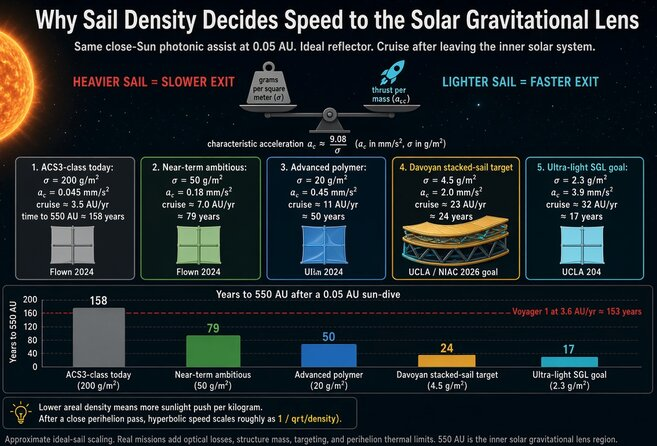

# NASA超轻太阳帆比现有轻40倍，能送望远镜到冥王星20倍远外

> NASA先进创新研究正在打造下一代超轻太阳帆：特征加速度最高可达2毫米/秒平方，有效面积超过10000平方米，足以支撑超高delta-V任务。

封面图——下一代超轻太阳帆构型示意，目标是比现有帆轻12到40倍、更快。

## 一张比现有轻40倍的帆，能走多远

太阳帆不靠燃料，全靠阳光光子一次次碰撞推动飞船前行。面越大、越轻，加速度就越可观。NASA先进创新研究所瞄准的目标是特征加速度最高2毫米/秒平方、有效面积超过10000平方米的构型——这个量级能撑起超高delta-V的长期任务。

如果这条路走得通，望远镜可以被送到比冥王星还远20倍的地方。在那里，太阳的引力会像天然透镜，把光线聚焦增强10亿倍，天文学家就能直接给其他行星系成像。同一套技术还能派上更多用场：让航天器长期"驻留"在地球或金星极地上空持续观测、给太阳极区拍照，或者用相对便宜又快速的探测器飞向外行星。

## 卡住几十年的一道坎：帆布怎么展开

问题出在一个看似简单的环节。飞行速度要上去，帆就得做得又大又轻，但帆面积一增大，发射时的部署质量和复杂度就跟着剧增——展开一面巨大的帆膜，一直是把加速度推过0.3毫米/秒平方这道坎的最大障碍。这个数字多年难以突破，症结全在"展开"两个字。

NASA这场先进创新研究的新架构，干脆把"展开"从根上砍掉。方案分两路并进：其一，用一根可卷绕的桁架，把一摞各50到150平方米的小帆膜像楼梯一样依次展开，单面尺寸受火箭整流罩约束；其二，引入张拉整体工程来维持结构强度。展开之后，帆膜整体呈"阶梯"状，由贯穿每一面无框帆中心的中央可卷绕桁架支撑。

## 轻与快，指向更遥远的深空

真正让这张帆诱人的，是它把"轻"和"快"绑在了一起。现有的太阳帆动辄厚重笨拙，而新一代的目标是整整轻12到40倍。当日光是唯一的燃料、帆布是唯一的负重，太阳系边缘不再是遥不可及的终点——那片让太阳引力聚焦亿万倍光的深空，正在被一面更薄、更轻的帆一寸寸拉近。