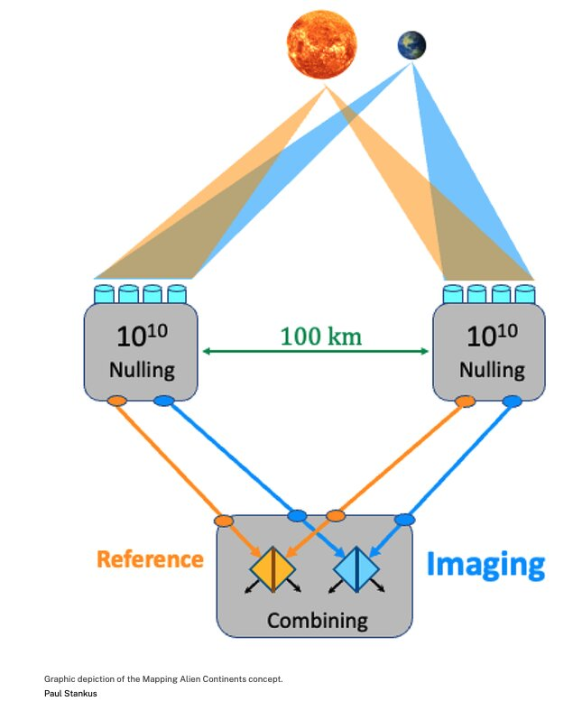

# 空间望远镜干涉仪将能绘制系外行星的大陆

> 一个 NASA NIAC 资助的概念提出：用两枚相距约 100 公里的编队飞行光学干涉仪，把宿主恒星的光抑制约 10^10 倍后，有望直接拍清十秒差距外地球大小行星表面的大陆与海洋——这些项目全程无需离开内太阳系。

NASA 概念构想的编队飞行光学干涉仪，有望直接成像系外行星表面的大陆轮廓。

## 编队飞行干涉仪如何"熄灭"恒星

该项目属于 NASA 创新先进概念计划（NIAC），目标是用编队飞行的光学干涉仪绘制外星大陆。核心思路是先解决最大难题——宿主恒星的强光遮蔽。两台分层归零器（nuller）相距约 100 公里，先把宿主恒星在可见光下的亮度抑制约 10^10 倍，再把残余的行星光合并成迈克尔逊干涉仪进行合成。

这套设计的关键在于基线长度。在 500 纳米波长下，100 公里的基线能带来约 1 微角秒（microarcsecond）的角分辨率。与之对照，位于 10 秒差距处的一颗地球大小行星，其角直径仅有约 8 至 9 微角秒——也就是说，这颗行星圆盘上只有几个分辨元。虽然不多，但原则上已足以分辨出最大反照率对比的区域，也就是大陆与海洋的分界。

## 从百公里基线到更大规模的构想

这套由 Stankus 提出的映射干涉仪方案，其优势是可以向更长基线扩展，与 Labeyrie 的超望远镜（hypertelescope）属于同一技术家族。100 公里基线已能给出约 1 微角秒的分辨率；若把基线拉长到数百公里，就能在行星圆盘上得到更细密的网格。

Labeyrie 的概念也从地基走向了更宏大构想的序列：从 57 米的地面原型，一路扩展到一个拥有 10000 面 3 米镜、跨度达 400 公里的"系外地球成像仪"（Exo-Earth Imager）。

## 需要在工程上翻越的坎

主要工程难度会随着基线的拉长而显著上升。数百公里的尺度上，需要纳米级的编队飞行与精密计量（metrology）、严苛的热稳定性与振动控制，同时还要解决光子数量不足的观测灵敏度问题。此外，这一方案是否比太阳引力透镜更便宜，仍是一个开放权衡。

曾几何时，这样的分辨率只有科幻小说里才有。如今，两项都无需离开内太阳系的构想，正把"看到另一颗地球上大陆的海岸线"从想象推向可验证的工程路径——而人类离这一天，也许并不像想象中那么遥远。