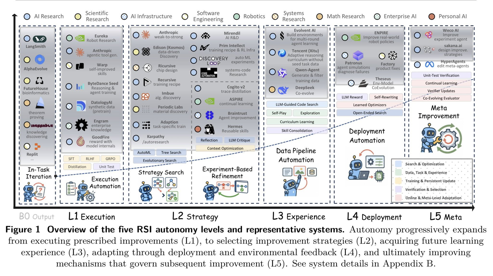

# AI连锁反应在哪里？审视自我改进的真相

> Sakana AI已走出早期demo，但作者并未找到它凭借持续加速的RSI拉开研究领先的证据。他提出"有用的RSI未必需要加速回报"，并给出检验自我加速研究所需的证据标准，同时呼应Dario与马斯克关于共享测试、加强AI防御的呼吁。

AI连锁反应在哪里？审视自我改进的真相

## 连锁反应在哪里：Sakana的进展与留白

Sakana AI已经走出了早期演示阶段。但Brian Wang审视后得出结论：**他没能找到证据表明Sakana通过持续、加速的递归自我改进（RSI），建立了不断扩大的研究领先优势。**其公开成果支持的是"有边界的自我改进"（bounded self-improvement）和越来越强的编排（orchestration）能力。

作者强调，真正该检验的问题要高出一档——**被改进过的研究者，是否能让下一次改进更快、更便宜、更有分量。**这才是"连锁反应"该有的样子。

## 安全优先：共享测试而非各自为战

文章连带抛出安全议题：当前AI相对我们脆弱不堪的软件系统已经足够强大，其风险超越单一公司能单独消化。作者点名两件事：**Anthropic CEO Dario在长文中提出的主张，以及马斯克在All-in Summit上的发言——都指向OpenAI的AI"蜂群攻击"Hugging Face事件。**AI有能力批量制造病毒和代码蠕虫（code worms）。

一个合意的起步动作是同行评审：**让美国、中国及全球所有公司共享测试框架（testing harnesses），互相测评彼此的系统。**这样各公司能得到可修复的反馈清单，让所有系统都更安全、更健壮；同时应把更多共享资源和精力投向加强网络防御与AI监控。

## RSI与规模战：算法自我加速为何还没占主导

到目前为止，RSI方法上的"越来越快"仍被另一股"越来越快"淹没——更快地融到更多钱、建更大的AI数据中心、抢到更顶尖的人才。企业可以靠建数据中心跑得更快，比如**SPACEXAI**在建设效率上更高。问题随之而来：**算法层面的RSI闭环，什么时候才真正接管竞争？**

作者用一个实战类比：一个招式每次能让你变强1.2倍，但下一次出手你可能就被淘汰，因为对方买下了现任重量级拳王。所谓"最关键、最重要的因素"，目前甚至压不住其他因素的总和——**连10%的权重占比都谈不上。**

## 有用的RSI未必需要加速回报

核心判断一条：**有用的递归自我改进，并不要求加速回报。**一个系统反复自我改进、哪怕每次增益逐渐递减，依然能创造可观的价值。

同样的逻辑反过来说：**拉开竞争差距既非加速回报的必要条件、也非充分条件。**"用AI让自己越来越快"这类更强的说法，意味着一旦某方在该领域领先，就能靠复利效应甩开对手——但对手同样可以同等速度改进、或者直接照抄已发表的方法；也可以靠买更多算力、签下更强研究员而反超。领先并不天然成立。

## 更强的自我加速研究，证据该长这样

如果真要检验是否存在"自我加速研究"，Brian Wang列出一套更严格的证据标准：

- **冻结变量**：锁定模型访问权限、总预算与评估标准；
- **横向对比**：让每一代"研究者"都在全新的、有分量的难题上互相比较；
- **量化产出**：度量单位美元与单位周内被采纳的改进量；
- **归因清晰**：把增益归到继承下来的改动上，区分外部模型升级与人类重设计；
- **迭代可复现**：晋升到下一代研究者后，增益是否反复出现；
- **落地验证**：确认这些增益能撑过真实系统的集成。

对照这套标准，作者的评价是：**Sakana确实展示了自我改进研究团队的若干片段，但尚未公开证明这个团队正在以加速节奏制造下一个突破。**

## 结语

对读者而言，本文更像一记冷却剂：炒作中的"AI连锁反应"尚未有硬证据坐实，而加速回报既非必要性前提、也不足以自行保证领先。作者建议把力气花在更务实的两件事上——**用统一测试标准互相测评让系统更稳健，以及盯紧AI蜂群攻击式的真实安全威胁。**

Brian Wang以发掘前沿技术著称，目前是一家初创公司的联合创始人、高潜力早期项目募资人，同时在深科技投资机构Allocations担任研究主管，并是Space Angels的天使投资人。他常在大型企业演讲，曾任TEDx演讲者、奇点大学（Singularity University）讲师，多次做客广播与播客访谈，也接受公开演讲与合作邀约。