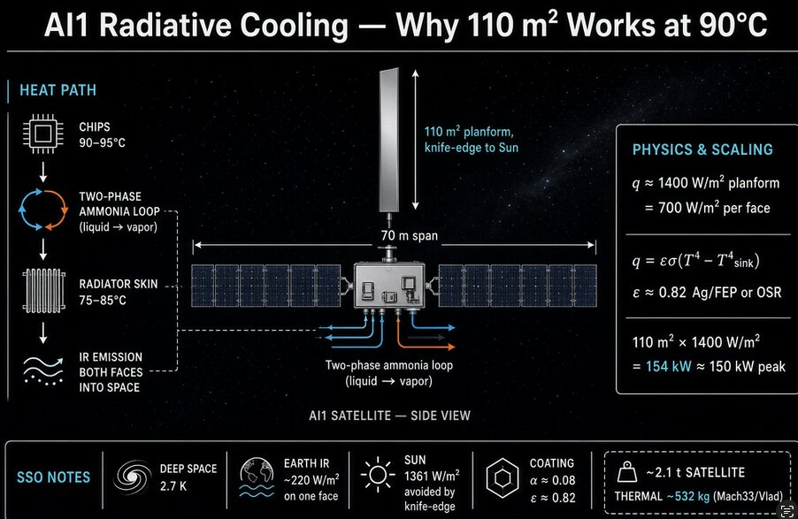

# SpaceX Starmind：太空AI计算的散热难题与刀边散热器设计

> SpaceX 与 XAI 的顶尖工程师团队正联合设计面向太空的 AI1 系统——覆盖 80% 在轨卫星、另有 10% 地球 AI 数据中心背景的团队，正在把 AI 算力推入轨道，而散热器尺寸问题是外界最常见的质疑。

SpaceX 与 XAI 联合设计的太空 AI 系统概念图——刀边散热器置于双太阳翼之间，利用深空低温环境进行高效散热。

## 太空散热器真的不够大吗？

外界常见的一个反对意见是「太空散热器太小」。然而这个质疑通常存在一个根本性的误区：它把太空当成了一个室温的热沉（heat sink），忽略了热量排出量随绝对温度的四次方（T⁴）剧烈缩放的物理事实。一个 110 平方米的散热板从**两面**同时向太空辐射热量，其实际散热能力远超直观想象。

对此，独立技术分析者 Mach33 / Vlad Saigau 从第一原理出发，重构了同一张示意图，得出了与 SpaceX 所描述的完全一致的热力学结论：一颗约 2.1 吨的卫星，其中热系统质量约 532 公斤（占总质量的 25% 左右），配备 110 平方米、已验证的 2.5–5 公斤/平方米面密度散热器。结合 Musk 提到的 1,400 W/平方米的散热功率密度数据，可以推断芯片工作温度接近 95°C。

## 深空真的是 2.7K 吗？

理论上，深空背景温度约为 2.7K，但一颗太阳同步轨道（SSO）的低地球轨道卫星实际面对的热环境复杂得多：

- **直接太阳辐射**：约 1,361 W/平方米
- **地球红外辐射**：地球面一侧约 200–240 W/平方米
- **地表反照率（Albedo）**：若轨道为黎明-黄昏（dawn-dusk）或高 beta 角，贡献较小

卫星将散热器以「刀边」方式飞行于太阳方向——几乎没有直接暴露在太阳下的面积，两个面都向外发射红外辐射，其中一个面仍会接收到一定的地球辐射。

因此，单纯说「太阳同步轨道温度是多少」是没有意义的。真正有用的数值是经过涂层和姿态调整后的**有效热沉温度**，而不是 3K。

## 110 平方米对应 154 kW 散热——恰好匹配 150 kW 峰值设计

简化计算：110 平方米散热器每平方米辐射 1,400 W，即总计约 154 kW——这一设计尺寸显然是针对 150 kW 峰值算力的。如果未来卫星算力提升至 250 kW，散热器面积将需要增加至约 183 平方米，而太阳能电池板面积大约是散热器的 5.5 倍。

Starship 的低成本发射能力使得这种大型太空计算平台的部署在经济上变得可行——这是过去火箭发射成本无法支撑的方案。

## 太空 AI 还是地球数据中心？

对比太空 AI 系统与地球数据中心时，若不计入 GPU 芯片本身（两者使用相同的 GPU 芯片），仅从系统散热和部署角度，太空方案展现出了独特的优势：深空的极低背景温度使得同样功率的芯片在太空中更容易散热，前提是散热器设计得当。

---

Brian Wang 长期致力于前沿技术的甄别与趋势发现，现为一家初创公司的联合创始人兼高潜早期企业的筹资人。他是 Allocations 机构的深度技术投资研究负责人，同时也是 Space Angels 的天使投资人。

他曾多次受邀在各大企业演讲，做过 TEDx 演讲、硅谷大学（Singularity University）演讲，并接受过众多广播节目和播客采访。目前他也欢迎各类公开演讲和咨询合作机会。

*原文源自 NextBigFuture，探讨了 SpaceX 与 XAI 合作的太空 AI 系统在散热设计上的关键考量，反映了太空计算基础设施进入实质设计阶段的信号。*
