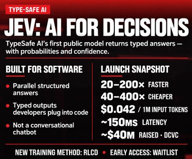

# Typesafe AI JEV 是 AI 决策与分类的变革性突破，为 AI 软件带来巨大的速度与成本节省

> Typesafe AI 宣布 JEV 技术可实现超快、超廉价的分类、排序与决策操作，并且能快速响应数据库更新——号称能以 9 美分的成本在眨眼间完成数千封邮件的整理。

NextBigFuture 发布于 2026 年 9 月 19 日的 Typesafe AI JEV 预告帖封面——文章本身尚未完成正文，仅挂载了标题与封面截图。

## 预告帖，尚无正文

这是一篇典型的"预告式帖子"。NextBigFuture 的这篇文章正文极度精简，几乎只包含一句话的产品宣传语：

> Typesafe AI – Superfast, super cheap classifications, sorting, decisions. Also rapid response updating to databases. Sort through thousands of emails in fraction of a second for 9 cents.

除此之外，文章主体仅剩下固定的 Brian Wang 作者简介与博客标准排版组件（近期文章列表、分类菜单等）。作者似乎挂了一张封面截图，意在预告即将展开的内容，但截至发稿，正文尚未完成。读者若期待对 JEV 技术的技术细节、基准测试数据或实际应用案例的展开，目前还不得而知。

## Brian Wang 简介

这篇文章出自 Brian Wang 之手，他是 NextBigFuture 博客的作者，也是业内知名的前沿技术识别者。目前他身兼数职：一家初创公司的联合创始人、高潜力早期企业的筹资人、专注于深科技投资的 Allocations 研究主管，以及 Space Angels 的天使投资人。

他曾多次在各类企业演讲，也是 TEDx 演讲者、 singularity University 演讲者，并受邀出现在众多广播与播客节目中。他现在也对公开演讲与咨询类的合作持开放态度。

## 结语

Typesafe AI 的 JEV 概念——在分类、排序与决策任务上追求极致速度与低成本——若能如其所描述的那样，在毫秒级时间内处理千量级邮件且成本仅需 9 美分，那么对于依赖 AI 进行数据筛选与业务决策的软件系统而言，确实可能是一个颠覆性的基础设施升级。不过，目前我们所能看到的只有这一句宣传语与一张封面图片。敬请期待后续正文。

<!-- 文末不加标签、不加"本文编译自" -->
