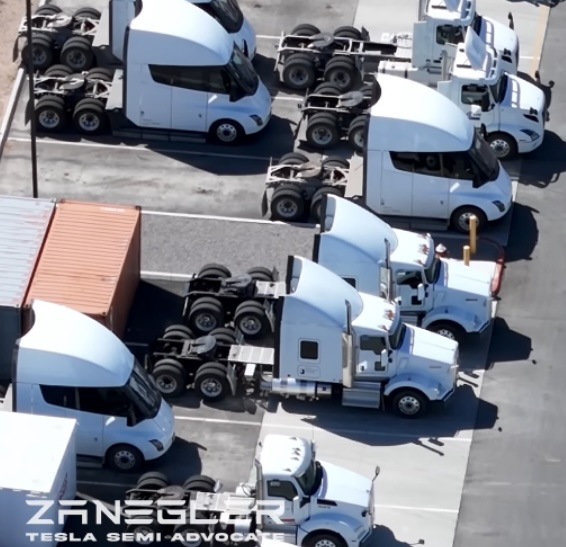

# 摩根士丹利 13 个月后才确认特斯拉自动驾驶卡车机会

> 作者布莱恩·王 13 个月前率先指出特斯拉自动驾驶卡车（Robotruck）机会，如今摩根士丹利也跟进，给出 840 美元目标价。特斯拉 Semi 搭载全自动驾驶（FSD）后单辆年盈利可达 65 万美元，是机器人出租车的 10 倍。

特斯拉 Semi 卡车。随着 FSD 技术成熟，这款卡车有望转变为自动驾驶货运工具，创造远超机器人出租车的利润。

## 我早 13 个月就看到了，摩根士丹利现在才跟进

13 个月前，我就已经详细分析过特斯拉自动驾驶卡车（Robotruck）这一机会。如今摩根士丹利也终于找到了同样的机会，并因此给出了 840 美元的目标价。不过，市场上仍有许多人没能看懂特斯拉 Semi 卡车搭载全自动驾驶（FSD）后所蕴含的盈利潜力和股价影响。

FSD 正在奥斯汀稳步推进，FSD 14 版本将于 9 月发布，参数量将提升 10 倍。

## 自动驾驶卡车的利润是机器人出租车的 10 倍

自动驾驶卡车的盈利能力远超特斯拉 Cybercab 机器人出租车。每辆自动驾驶卡车每年可带来约 65 万美元的利润，而机器人出租车每年的利润仅为 5 万至 7 万美元。

背后的逻辑很清晰：卡车可以每天运行 22 个小时，每年行驶 20 万至 35 万英里——是出租车的 4 到 7 倍。每英里的收入与出租车相当（2 美元至 2.60 美元），但总拥有成本更低，没有驾驶员的情况下每英里仅 32 至 34 美分。

## 产能爬坡与 FSD 的快速进展

特斯拉 Semi 的试点生产已经启动，内华达工厂也已建成。产量正朝着每年 5 万台的目标爬坡，而 FSD 的进展也在加速。

与机器人出租车不同，卡车运输是纯商业市场，全球市场规模稳定在 2 万亿美元。机器人出租车则可能面临与个人汽车竞争导致的收入下降（可能降至每英里 70 美分）的风险，而卡车运输没有这个问题。

## 特斯拉估值的巨大升水空间

这一自动驾驶卡车业务将推动特斯拉估值大幅飙升。保守估计到 2030 年可为每股带来 3,000 至 6,000 美元的增量；若能捕捉全部市场机会（包括机器人出租车在内），股权价值甚至可达到 80 万亿美元。

此外，Optimus 机器人若能将效率和需求提升 4 倍，将进一步释放新的物流模式和经济增长空间。

## 作者简介

布莱恩·王（Brian Wang）以识别前沿技术著称，目前是一家初创公司的联合创始人兼高潜力早期企业的筹资人。他是 Allocations 公司的深度科技投资研究负责人，同时也是 Space Angels 的天使投资人。

他经常在各大企业演讲，曾担任 TEDx 演讲者、硅谷大学（Singularity University）演讲者，并接受过 numerous 广播和播客采访。欢迎公开演讲和咨询类合作。
