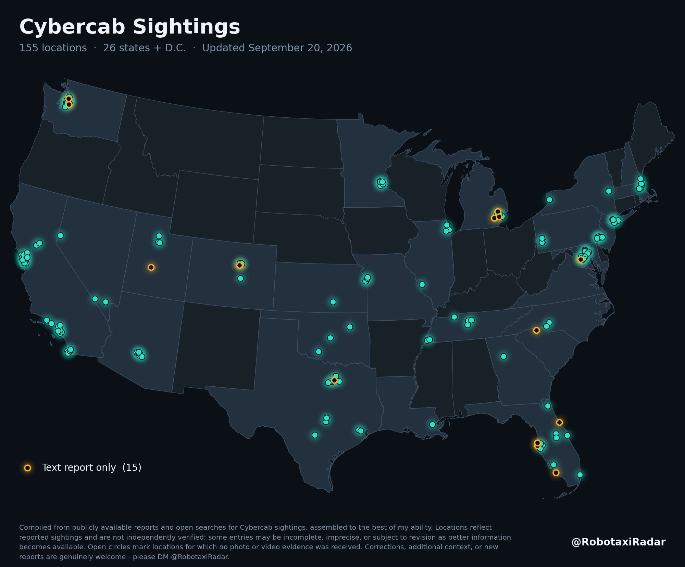

# 北方还要等的 Cybercab 与 Robotaxi：也许要等到 2027 年的 FSD 16.X

> 在加拿大等北方地区等 Robotaxi 的人，得先等 FSD 15.X 向所有 AI4（HW4）车型全量推送、等到每个现有城市投放超过 2000 辆，才轮得到新城市。

特斯拉 Cybercab 已在芝加哥、西雅图等靠近加拿大边境的城市上路测试，北方用户还要再等上一阵。

## 北方城市排在很后面

在加拿大等北方地区等待 robotaxi 或 cybercab 的人，大概得先等 FSD 15.X 面向所有 AI4（也就是 HW4）特斯拉车型大规模推送。除此之外，还得等到现有每个城市的 robotaxi 数量超过 2000 辆，之后才轮到 Las Vegas、Phoenix 等新城市——这一整套走完，可能要等到 2027 年晚些时候的 FSD 16.X。

不过仍有希望：已经有特斯拉 Cybercab 在芝加哥、西雅图以及其他靠近加拿大边境的美国城市进行测试。

## 一条由前置条件串起来的时间线

这条判断没有给出确定日期，只给出一串前置条件：车型覆盖、单城投放规模、新城市扩张，最后才谈得上更北地区的落地。对盼着 Robotaxi 北上的人来说，结论只有一句：耐心。
