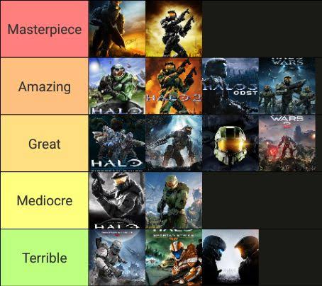

# 烂了十年的《光环》游戏终于要换人做了

> Halo Studios 将不再负责《光环》系列，这家被指雇了一批既讨厌《光环》又讨厌枪的员工的工作室裁掉268人，游戏制作权被移交给了 Activision。

《光环》系列在近十年里口碑持续走低，制作权如今交到了 Activision 手里。

## 268人被裁，制作权交给 Activision

Halo Studios 将不再开发《光环》游戏。这家公司裁掉了268名员工，并把《光环》的游戏制作移交给了 Activision。

这并不意味着 Activision 一定能做出出色或惊艳的《光环》。但至少，"结果百分之百糟糕"不再是唯一可能出现的结果。

## 问题不只是换谁来开发

真正值得追问的是另一件事：商人们为了利润接手娱乐游戏和内容时，能否有足够的动力，把那些创造过辉煌、也曾红极一时的宝贵知识产权，交到真正热爱它们原本模样的人手里。
