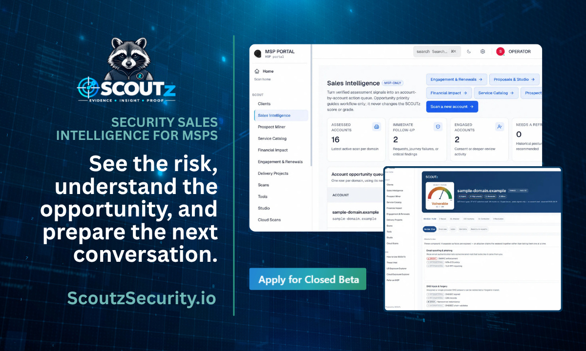

# SCOUTz 面向MSP推出客户情报平台，开放30天免费公测

> 专为托管服务商（MSP）安全销售打造的客户情报平台 SCOUTz 进入公开测试，能让 MSP 在第一次见面之前就拿到关于潜在客户环境的"带日期证据"，并在交付与复核过程中一直保留这些证据。

SCOUTz 希望在 MSP 的"约到会"和"签下合同"之间补上一块空白。

## 30天免费，之后每月279美元

该平台于2026年9月24日在亚利桑那州凤凰城发布，公测入口为 https://scoutzsecurity.io/open-beta。自工作区开通起30天内免费，之后按标价每月279美元。在此次公开测试之前，来自三个同行社区的50家 MSP 已通过封闭测试参与了产品塑造。

MSP 渠道里有不少工具能帮公司约到第一次会面，也有若干在签约之后才发挥价值的工具，比如专业服务自动化（PSA）和远程监控与管理（RMM）平台。但从"会议已约"到"合同已签"之间那段真正做销售的区间，长期只能靠模板和销售自己准备。SCOUTz 就是冲着这段空白来的。

## 不装Agent、不登录，就能扫出156项检查

在会面之前，SCOUTz 会把公开的企业事件——新办公点、IT 招聘、已公布的计划——与自己掌握的外部带日期证据配对，让 MSP 到场时就知道这家客户为什么值得谈、该问什么。域名审查无需安装代理、无需登录，覆盖邮件认证、证书、子域、暴露服务等，共156项检查，取自一个实时的证据库。每项检查都附有文字说明和下一步建议。外部可见的信号从不被当作内部控制的证据，只用来支撑更好的提问。

在潜在客户同意的前提下，SCOUTz 还能通过只读连接查看 Microsoft 365 的配置：身份、应用授权、安全设置与受管设备上下文。它不安装任何东西，也不做任何更改，并且不读取邮件、文档、文件或聊天记录。

每一条发现都可追溯到一项带日期的检查和一个具名的证据来源，未知项永远不会被算成"干净"。发现项附带修复指南、工作计划和可直接开单的文案。重新扫描会把新证据与固定基线对比，使下一次季度复核建立在"什么变了"之上。基于同一批证据，平台会生成面向企业主的客户版报告，以及面向技术团队的运营版报告。

## "别拿着PPT走进会议室"

"有大量工具、项目和营销公司能帮 MSP 拿到第一次会面，"SCOUTz 创始人、RYTHMz 首席执行官 Steve Copeland 说，"但没有任何一个能让 MSP 走进那间会议室时，已经知道这家企业某个真实的情况。我亲手建过两家 MSP，我知道拿着一份幻灯片和一个故事走进去、只换来一句'以后再联系'是什么感受。"

平台的边界是刻意设定的。SCOUTz 从设计上就是只读的，也不去为假想中的入侵估算金钱损失。AI 负责起草说明文字；发现是否成立由确定性检查判定，最终的主张由人来负责。

"这个行业里每个人都见过那种幻灯片——上面印着某位员工被盗的密码，"Copeland 说，"我们拒绝做那样的东西。恐惧能帮你约到会，却会毁掉关系。把检查了什么、发现了什么、什么时候发现的摆到企业主面前，他们自己就能做决定。"

一位封闭测试参与者开完客户会一出来就用手机跑起了这个平台。"唉，我真希望刚才那场会我就有这个，"德克萨斯州埃尔帕索的托管IT与网络安全公司 Net-Tech Consulting 总裁兼合伙人 Zach Kinder 说。

## 由 RYTHMz 出品

Copeland 是在出版《The 3AM Test for MSPs》——一本关于托管服务商"基于证据销售"的商业书——九个月后做出 SCOUTz 的。用户无需注册即可在 https://scoutzsecurity.io/tools 获取一份免费的公开域名评分。

按官方说法，SCOUTz 是面向托管服务商的"安全销售情报"：第一次会面之前的客户背景与带日期证据，在复核、交付和重新评估全程保持挂接，让 MSP 卖出去的故事，就是它随后能证明的故事。SCOUTz 由 RYTHMz 打造，自筹资金，总部位于亚利桑那州凤凰城。RYTHMz 是2025年 ASCII Cup 年度供应商，一家只做渠道的5G连接公司，拥有180多家 MSP 合作伙伴。
