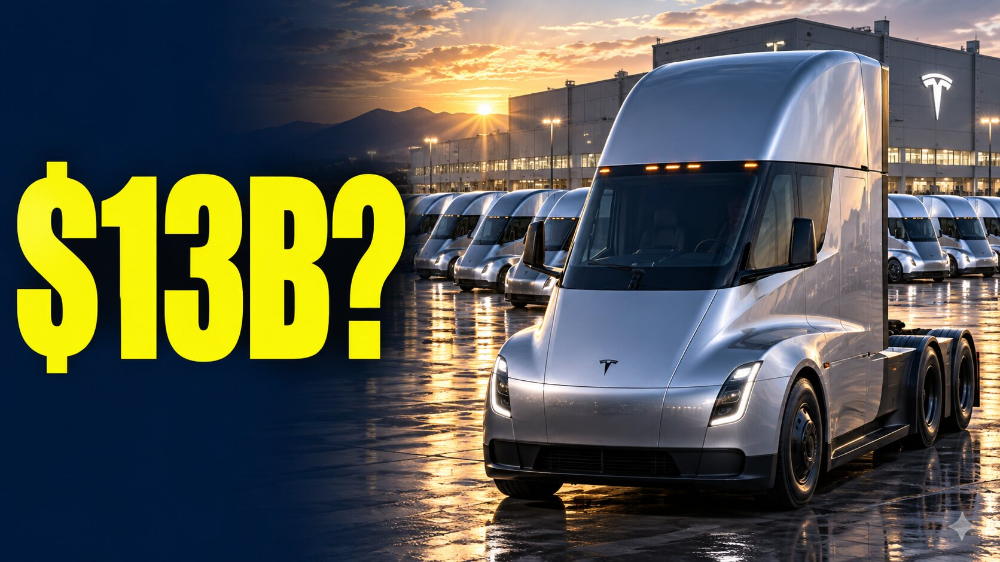

# 特斯拉Semi发布会前先算账：3万辆就是80亿美元，卡车FSD可能比卖车更赚钱

> 在特斯拉Semi交付活动开始前，NextBigFuture 创始人 Brian Wang 给出了一组测算：2027年卖出3万辆Semi，按每辆26万至29万美元计算，车辆营收约80至90亿美元；若按5万辆、每辆26万美元算，年营收可达130亿美元。

特斯拉Semi即将交付，卖车之外的软件与自动驾驶收入成为另一个观察重点。

## 先把Semi的账算清楚

在特斯拉Semi正式交付之前，有几笔账值得先摆在桌上——它们决定了你该如何解读发布会上的订单、产能规划、充电设施和自动驾驶条款。

按 Brian Wang 的测算，2027年售出3万辆Semi，以每辆26万至29万美元的价格计算，对应约80至90亿美元的车辆营收；若年销5万辆、单价按26万美元计，年营收可以达到130亿美元。而如果要在这样的营收规模上实现每季度10亿美元利润，需要的利润率大约是31%。

## 卡车FSD可能比卖车更赚钱

真正有想象空间的部分在软件。卡车版FSD若定价为每年4万美元，或无人监督运营下每年8万美元，就可能形成一块体量可观的经常性收入业务：只要5万辆卡车付费，每年就是20至40亿美元。

这也是评估Semi Day各项安排时最需要注意的一点——车卖多少只是故事的一半。

## 被低估的Robotaxi车队

同一时期，Wang 还重申了他对特斯拉Robotaxi车队规模的判断：他的估算是510至520辆无人监督Robotaxi，而公开追踪器快照里只观测到314辆。

他的理由是，统计被拍到的车牌号只是抽样，不是完整的车队普查。重复目击和覆盖范围不足会掩盖爬坡过程，而随着车队规模扩大，被漏掉的车辆数量可能急剧增加。理解这个基线差异，是判断Robotaxi真实增长速度的前提。

## 数字的来源与边界

需要说明的是，这些车队数据来自录制当时的快照以及作者的重建推算。Semi的销量、利润率和卡车FSD定价都属于前瞻性计算，并非公司公布的结果或官方订阅价格。

作者也把自己这套测算与2025年8月的robotrucking分析接了起来——那份分析比摩根士丹利随后关于特斯拉Robotrucking机会的报告早了大约13个月。围绕这次交付活动的讨论，最终都会回到同一个问题：卖车是一次性的收入，而卖每英里、卖自动驾驶能力，才是能持续复利的生意。
